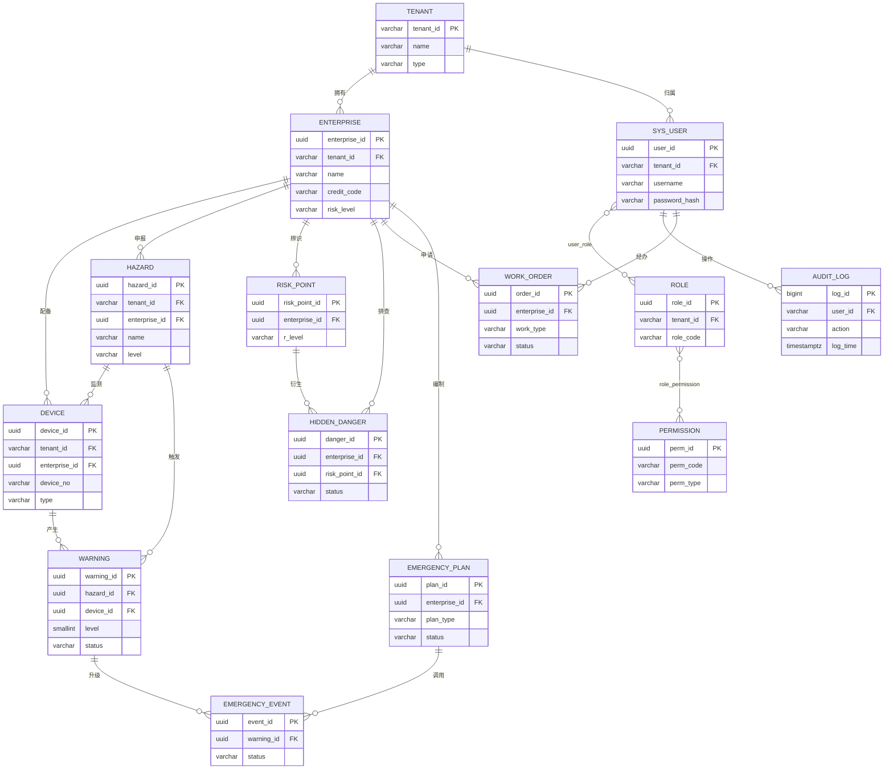
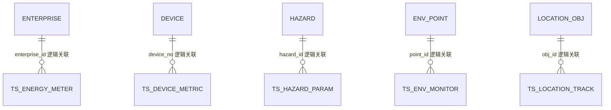

# 数据库设计说明书

> **项目名称**：化工园区安全环保一体化智慧管控平台（以下简称"平台"）
> **文档版本**：V2.0（专业深化版）
> **编制日期**：2026-09-02
> **数据库引擎**：PostgreSQL 14（业务关系库）+ TimescaleDB 2.14（时序库，PostgreSQL 扩展）
> **配套文档**：《微服务架构设计方案》《时序数据库表结构设计》《服务接口契约与事件设计》《等保三级安全加固检查清单》《应急演练与容灾切换预案》《Kubernetes-Helm 部署清单示例》《架构决策记录 ADR》

---

## 目录

1. [文档说明](#1-文档说明)
2. [概述](#2-概述)
3. [数据库需求分析](#3-数据库需求分析)
4. [数据库总体架构设计](#4-数据库总体架构设计)
5. [实体关系模型（ER）](#5-实体关系模型er)
6. [业务关系数据库数据字典](#6-业务关系数据库数据字典postgresql)
7. [时序数据库设计（TimescaleDB）](#7-时序数据库设计timescaledb)
8. [索引设计与性能优化策略](#8-索引设计与性能优化策略)
9. [数据安全设计](#9-数据安全设计)
10. [备份与恢复策略](#10-备份与恢复策略)
11. [数据库版本控制与变更管理](#11-数据库版本控制与变更管理)
12. [数据库部署与运维维护要求](#12-数据库部署与运维维护要求)
13. [附录](#13-附录)

---

## 1. 文档说明

### 1.1 编制目的

本说明书定义平台全部数据持久化层的结构与运维标准，作为开发、测试、DBA、运维及等保测评的共同依据，具体包括：

- 明确数据库需求边界（功能需求与非功能需求）；
- 定义逻辑/物理数据模型、实体关系与完整数据字典；
- 规定索引、分区、压缩、缓存等性能设计；
- 规定安全、备份恢复、版本变更、部署运维的强制要求。

### 1.2 适用范围

适用于平台业务关系库（PostgreSQL 14）与时序库（TimescaleDB 2.14）的设计、开发、部署与运维；Redis（缓存）、Kafka（事件流）、MinIO（对象存储）仅描述与数据库的协作边界，其内部结构见各自专项文档。

### 1.3 读者对象

| 读者 | 关注内容 |
|------|----------|
| 架构师 / DBA | 总体架构、容量、性能、高可用、变更管理 |
| 后端开发工程师 | 数据字典、ER 关系、索引、SQL 规范、迁移脚本 |
| 测试工程师 | 数据约束、一致性模型、恢复演练验证点 |
| 安全 / 等保测评人员 | 第 9 章安全设计、审计、加密、权限模型 |
| 运维工程师 | 第 10、12 章备份恢复、部署监控、巡检 |

### 1.4 编制依据

| 类别 | 依据 |
|------|------|
| 国家标准 | GB/T 22239-2019《信息安全技术 网络安全等级保护基本要求》（第三级） |
| 行业规范 | 《化工园区安全风险智能化管控平台建设指南（试行）》、《危险化学品企业安全风险智能化管控平台建设指南（试行）》、HJ 212《污染物在线监控（监测）系统数据传输标准》 |
| 项目文档 | BRD/MRD/PRD、微服务架构设计方案、ADR 架构决策记录、容灾切换预案 |
| 技术基线 | PostgreSQL 14 官方文档、TimescaleDB 2.14 官方文档、Flyway 数据库版本控制规范 |

### 1.5 术语与缩略语

| 术语 | 说明 |
|------|------|
| MDM | Master Data Management，主数据管理（企业、设备、危险源、租户等） |
| Hypertable | TimescaleDB 超表，按时间自动分块（chunk）的分区表 |
| Continuous Aggregate | TimescaleDB 连续聚合物化视图，自动增量刷新 |
| WORM | Write Once Read Many，只追加不可篡改存储（审计日志） |
| RLS | Row Level Security，PostgreSQL 行级安全策略 |
| RTO / RPO | 恢复时间目标 / 恢复点目标 |
| PITR | Point-In-Time Recovery，基于 WAL 的时间点恢复 |
| TDE | Transparent Data Encryption，透明数据加密（存储卷加密） |
| RBAC | 基于角色的访问控制（模块级 / 功能级 / 数据级三级） |

### 1.6 修订记录

| 版本 | 日期 | 修订说明 | 作者 |
|------|------|----------|------|
| V1.0 | 2026-08-22 | 初版：分层、核心表、外键、时序超表 DDL、备份概述 | 架构组 |
| V2.0 | 2026-09-02 | 全面深化：补充需求分析、ER 模型（Mermaid）、完整数据字典、性能优化、安全设计、备份恢复、版本变更管理、部署运维要求；修正用户-角色关系为 N:M（`user_role`）；时序库编码列长度对齐 UUID（VARCHAR(36)） | 架构组 |

---

## 2. 概述

### 2.1 项目背景

平台面向化工园区安全、环保、应急、能碳、封闭化管理等业务域，由 14 个微服务构成（详见微服务架构设计方案）。数据层呈现两类截然不同的负载：

- **业务关系数据**：企业档案、设备台账、危险源、隐患、作业票、预案、用户权限等，低频变更、强一致、事务复杂；
- **时序数据**：IoT 点位（温度/压力/液位/可燃有毒气体）、环保监测、能碳计量、人员车辆定位轨迹等，高频写入、时间窗口聚合、海量历史回溯。

依据 ADR-005，两类负载分别采用 PostgreSQL 14 与 TimescaleDB 2.14 承载，统一 SQL 生态、降低运维与学习成本。

### 2.2 数据库建设目标

1. **数据可信**：主数据强一致、审计不可篡改、跨服务事务最终一致可追溯；
2. **性能达标**：监测看板 10s 刷新、IOC 大屏 30s 刷新、时序写入峰值 ≥ 2 万行/秒；
3. **安全合规**：满足等保 2.0 三级对访问控制、安全审计、数据保密性/完整性、备份恢复的全部要求；
4. **可运维**：高可用自动切换、RTO ≤ 30min / RPO ≤ 5min、变更可审计可回滚；
5. **可演进**：Schema 按微服务域隔离，支持单园区私有化与 SaaS 多园区两种部署形态。

### 2.3 总体技术路线

- **统一实例、按域 Schema**：业务库单实例内按微服务域划分 Schema（`mdm`、`safety`、`env`、`energy`、`emergency`、`iot`、`audit` 等），逻辑属主服务独占写入，物理上便于统一备份与跨域 JOIN；
- **多租户行级隔离**：所有业务表首列 `tenant_id`，应用层 JDBC Filter 注入 + 数据库 RLS 双重保障；
- **时序窄表 + 标签字典化**：时序库只存编码与值，主数据留在业务库，避免宽表膨胀；
- **高可用**：Patroni + 流复制（1 主 2 备，含同城同步备库），PgBouncer 连接池；
- **变更受控**：Flyway 迁移脚本纳入 Git，PR 审核 + CI 验证 + 灰度发布，禁止生产环境手工 DDL。

---

## 3. 数据库需求分析

### 3.1 业务域与数据来源

| 业务域 | 属主服务 | 主要数据实体 | 数据来源 |
|--------|----------|--------------|----------|
| 主数据 | mdm-svc | 租户、企业、重大危险源 | 企业建档、工商数据导入 |
| 设备资产 | device-svc | 设备/传感器台账、维保记录 | 设备建档、维保工单 |
| 身份认证 | iam-svc | 用户、角色、权限、审计日志 | 组织人事、登录行为 |
| 安全管理 | safety-svc | 风险点、隐患、特殊作业票 | 双重预防机制、作业审批 |
| 监测预警 | monitor-svc | 预警记录、阈值规则 | 时序数据越限派生 |
| 采集接入 | iot-ingest-svc | 边缘网关、点位映射 | 网关注册、点表配置 |
| 环保监管 | env-svc | 监测点/排口、固废联单 | HJ212 上报、台账录入 |
| 能碳管理 | energy-svc | 能源计量、碳配额/核算 | 计量仪表、核算模型 |
| 封闭化 | closedmgmt-svc | 出入记录、电子围栏、定位轨迹 | 门禁卡口、UWB/GPS |
| 管廊设施 | corridor-svc | 管线、巡检任务 | 设施台账、巡检系统 |
| 应急指挥 | emergency-svc | 预案、应急资源、应急事件 | 预案编制、接处警 |
| 园区运营 | operation-svc | 门户内容、物流协同 | 运营录入 |

### 3.2 功能需求

#### 3.2.1 业务关系库功能需求

| 编号 | 功能需求 | 数据层要求 |
|------|----------|------------|
| FR-DB-01 | 多租户建档与隔离 | 租户/企业/用户三级体系，行级 `tenant_id` 隔离，跨租户查询物理不可见 |
| FR-DB-02 | 主数据全生命周期 | 企业、设备、危险源 CRUD + 逻辑删除 + 变更留痕；支持批量导入导出 |
| FR-DB-03 | RBAC 三级权限 | 用户-角色-权限多对多；权限粒度到模块/功能/数据级（企业范围） |
| FR-DB-04 | 双重预防机制 | 风险点四色分级（红橙黄蓝）、隐患排查-整改-复查闭环状态机 |
| FR-DB-05 | 特殊作业票审批 | 八大类作业票（动火、受限空间、高处、破土、吊装、盲板抽堵、临时用电、断路），多级审批状态流转 |
| FR-DB-06 | 预警闭环管理 | 四级预警（红橙黄蓝）生成、确认、处置、解除全流程，关联告警时序列证据 |
| FR-DB-07 | 预案与应急资源 | 预案版本化管理（草稿/审核/发布/废止）、资源一张图、事件接处警记录 |
| FR-DB-08 | 操作审计 | 全部写操作留痕：操作人、时间、IP、对象、内容，WORM 不可删改，留存 ≥ 6 个月 |
| FR-DB-09 | 跨服务事务 | 作业票审批、隐患闭环等跨域操作经 Saga/TCC 保证最终一致，本地事务表（`saga_log`）记录补偿状态 |
| FR-DB-10 | 数据字典与编码 | 设备位号、统一社会信用代码、HJ212 MN 号等业务编码唯一约束 |

#### 3.2.2 时序库功能需求

| 编号 | 功能需求 | 数据层要求 |
|------|----------|------------|
| FR-TS-01 | 高频点位接入 | OPC UA/Modbus/MQTT/HJ212 协议数据经 Kafka `iot.raw` 落库，批量写入，支持至少一次投递 + 幂等 |
| FR-TS-02 | 实时看板查询 | 危险源最近 1 小时参数曲线 10s 刷新；区域人数、环保超标实时统计 |
| FR-TS-03 | 历史趋势回溯 | 任意时间区间曲线拖拽查询，自动降采样（1min/5min/1h 聚合） |
| FR-TS-04 | 越限标记 | `is_alarm`/`is_over` 布尔标记随数据写入，支持快速过滤统计 |
| FR-TS-05 | 定位轨迹 | 人员 UWB / 车辆 GPS 轨迹写入，电子围栏越界标记，支持区域人数聚合 |
| FR-TS-06 | 能碳计量 | 电/水/蒸汽/天然气计量值与功率、碳当量，小时/日/月聚合统计 |
| FR-TS-07 | 冷热分层 | 热数据高速存储、冷数据列式压缩（≥10x）、超期自动降采样/清理 |

### 3.3 非功能需求

| 类别 | 指标编号 | 指标要求 | 验证方式 |
|------|----------|----------|----------|
| 写入性能 | NFR-P-01 | 时序写入 ≥ 5,000 行/s 持续、峰值 ≥ 20,000 行/s（批量 COPY） | 压测报告 |
| 查询性能 | NFR-P-02 | 主键/索引查询 P95 ≤ 200ms；列表分页 P95 ≤ 500ms；统计报表 P95 ≤ 3s | APM/慢查询日志 |
| 查询性能 | NFR-P-03 | 监测看板 10s 刷新、IOC 大屏 30s 刷新、页面首屏 ≤ 5s | PRD 验收 |
| 并发能力 | NFR-P-04 | 注册用户 ≥ 5,000，在线 ≥ 1,000，并发事务 ≥ 200，数据库连接池化 | 压测报告 |
| 可用性 | NFR-A-01 | 数据库可用率 ≥ 99.9%（年计划外停机 ≤ 8.76h）；主库故障自动切换 ≤ 60s | Patroni 演练 |
| 容灾 | NFR-A-02 | RTO ≤ 30min，RPO ≤ 5min | 半年恢复演练 |
| 数据留存 | NFR-C-01 | 审计日志 ≥ 6 个月（关键操作 ≥ 1 年）；危险源/环保时序 ≥ 365 天；定位轨迹 ≥ 90 天；能碳小时聚合 ≥ 730 天 | 保留策略核查 |
| 安全合规 | NFR-S-01 | 等保 2.0 三级：TLS 1.3 传输、敏感字段 AES-256、存储 TDE、WORM 审计、三员分立 | 等保测评 |
| 可维护 | NFR-M-01 | 全部 DDL 经 Flyway 版本化；备份成功率 100%；监控覆盖率 100% | 运维台账 |
| 可扩展 | NFR-M-02 | 容量扩容在线完成（磁盘使用率 70% 触发）；新增业务域以新 Schema 接入 | 架构评审 |
| 数据一致 | NFR-D-01 | 主数据强一致（同步复制）；IoT 数据最终一致、可重传不丢失；告警有序不丢 | 一致性核查 |

### 3.4 数据分类分级

| 级别 | 数据示例 | 保护要求 |
|------|----------|----------|
| 公开级 | 预案公开版、政策文件 | 完整性保护 |
| 内部级 | 企业台账、设备档案、作业票 | 租户隔离、RBAC、传输加密 |
| 敏感级 | 危险源实时参数、预警记录、定位轨迹 | 行级权限 + 访问审计 + 脱敏展示 |
| 核心/个人 | 密码哈希、手机号/身份证、审计日志 | 字段加密（AES-256）、Argon2 哈希、WORM、最小化采集 |

### 3.5 数据量估算与容量预测（单园区基线）

| 数据类别 | 规模假设 | 日增量 | 年增量（原始/压缩后） |
|----------|----------|--------|----------------------|
| 企业 / 危险源 / 设备 | 200 家企业、约 300 处危险源、10,000 台设备 | < 1 MB | < 1 GB |
| 用户 / 权限 | 5,000 用户、200 角色 | < 1 MB | < 1 GB |
| 隐患 / 作业票 | 各约 50 张/工作日 | 约 5 MB | 约 2 GB |
| 预警记录 | 峰值约 1 万条/日 | 约 10 MB | 约 4 GB |
| 审计日志 | 约 1,000 万条/年（按月分区） | 约 30 MB | 约 15 GB |
| 设备点位时序 | 20,000 点位 × 平均 30s/次 ≈ 5,760 万行/日，约 90 B/行 | 约 5 GB（原始） | 保留 180 天：热数据约 150 GB + 压缩冷数据约 90 GB |
| 定位轨迹 | 2,300 目标 × 4s/次 ≈ 5,000 万行/日 | 约 4 GB | 保留 90 天：压缩后约 40 GB |
| 环保 / 能碳时序 | 500 监测点 × 1min/次 | 约 0.3 GB | 保留 365 天：压缩后约 15 GB |

> 容量规划结论：业务库 SSD ≥ 500 GB；时序库 SSD ≥ 1 TB（热数据盘）+ 对象存储归档（冷备份/WAL）。磁盘使用率达 70% 触发扩容。

---

## 4. 数据库总体架构设计

### 4.1 数据库选型决策

| 数据类型 | 存储引擎 | 选型理由（摘要，详见 ADR） |
|----------|----------|----------------------------|
| 业务关系数据 | **PostgreSQL 14** | 强事务（MVCC）、丰富约束/分区/RLS、JSONB、生态成熟、与 TimescaleDB 同构 |
| 时序数据 | **TimescaleDB 2.14**（PG 扩展） | 超表自动分区、连续聚合、列式压缩（10x+）、标准 SQL；否决 InfluxDB（生态割裂、多租户复杂） |
| 缓存/会话 | Redis（哨兵模式） | 在线状态、热点聚合、看板兜底缓存 |
| 消息/事件流 | Kafka 3.7（3 broker，ISR=2，acks=all） | 解耦削峰、分区键保序、至少一次投递 |
| 对象存储 | MinIO（EC 纠删码） | 抓拍图、视频、预案附件、加密备份归档 |

### 4.2 总体数据架构

```
┌──────────────────────────── 应用层（14 微服务）────────────────────────────┐
│  iam-svc  mdm-svc  device-svc  safety-svc  monitor-svc  env-svc ...        │
└──────┬───────────────┬───────────────────────────┬────────────────────────┘
       │ JDBC(HikariCP) │                           │ 批量 COPY
       ▼                ▼                           ▼
┌─────────────────┐  ┌──────────────────────────────────────────────────┐
│ 业务库           │  │ 时序库 TimescaleDB                                 │
│ PostgreSQL 14   │  │  超表 ts_device_metric / ts_hazard_param / ...     │
│ Schema:         │  │  连续聚合 v_*_5m / v_*_1h（大屏直查）               │
│  mdm/safety/env │  └───────────────▲──────────────────────────────────┘
│  energy/emerg.  │                  │ Kafka iot.raw（至少一次，幂等写入）
│  iot/audit/...  │          ┌───────┴────────┐
└───────┬─────────┘          │ iot-ingest-svc │
        │                    └───────▲────────┘
        ▼                            │ OPC UA/Modbus/MQTT/HJ212/GB28181
┌─────────────────┐          边缘网关 / DCS / PLC / 传感器
│ MinIO 对象存储   │◀── 加密备份（pg_dump/WAL 归档）、附件、抓拍
└─────────────────┘
```

### 4.3 部署与高可用架构

- **业务库**：Patroni 管理的 PostgreSQL 集群，**1 主 2 备**（同城 1 同步备库 + 1 异步备库/异地灾备），DCS 选用 etcd（3 节点）；前端 PgBouncer 事务级连接池 + HAProxy/VIP 自动切换；连接串经 Nacos 下发，主库切换无需重启应用。
- **时序库**：TimescaleDB 2.14（镜像 `timescale/timescaledb:2.14-pg14`），StatefulSet 2 副本 + 流复制，写入走主库，看板/报表查询走备库与连续聚合。
- **读写分离**：写事务 → 主库；大屏、报表、历史回溯 → 备库/连续聚合视图（通过服务内读写路由）。
- **K8s 部署**：中间件统一部署于 `chem-park-middleware` 命名空间，StatefulSet + PVC（SSD StorageClass），数据库口令经 `db-secret`（K8s Secret / Nacos 加密配置）注入，禁止明文。

### 4.4 Schema 规划与服务属主

物理统一实例、按业务域分 Schema；**表级属主服务独占写入**，其他服务经 API 或只读账号访问（Database-per-Service 的物理收敛形态）。

| Schema | 库 | 属主服务（写权限） | 核心表 |
|--------|----|--------------------|--------|
| `mdm` | 业务库 | mdm-svc：`tenant`/`enterprise`/`hazard`；device-svc：`device`/`device_maintenance`；iam-svc：`sys_user`/`role`/`permission`/`role_permission`/`user_role` | 主数据与权限 |
| `safety` | 业务库 | safety-svc：`risk_point`/`hidden_danger`/`work_order`；monitor-svc：`warning`/`threshold_rule` | 风险、隐患、作业票、预警 |
| `env` | 业务库 | env-svc | `env_point`、`env_outlet`、`waste_manifest` |
| `energy` | 业务库 | energy-svc | `energy_meter`、`carbon_quota` |
| `closed` | 业务库 | closedmgmt-svc | `access_record`、`geo_fence` |
| `corridor` | 业务库 | corridor-svc | `pipeline`、`inspection_task` |
| `emergency` | 业务库 | emergency-svc | `emergency_plan`、`emergency_resource`、`emergency_event` |
| `iot` | 业务库 | iot-ingest-svc | `gateway`、`point_mapping` |
| `operation` | 业务库 | operation-svc | 门户/物流/公文表（略） |
| `audit` | 业务库 | iam-svc 审计组件（仅追加） | `audit_log` |
| `public`（默认） | 时序库 | iot-ingest/monitor/env/energy/closed 各自写入 | 5 张超表 `ts_*` 及连续聚合视图 |

### 4.5 多租户隔离设计

- 所有业务表首列为 `tenant_id VARCHAR(32) NOT NULL`；唯一约束、复合索引均以 `tenant_id` 为前导列。
- **应用层**：MyBatis 拦截器/JDBC Filter 自动注入 `tenant_id` 条件（依据请求头 `X-Tenant-Id`），服务端强制校验，不依赖前端。
- **数据库层**：启用 RLS 行级安全策略（见 9.3），设置会话变量 `app.tenant_id`，双保险防止越权。
- 单园区私有化部署时 `tenant_id` 固定为园区编码，时序库可仅按 `time` 分区；SaaS 多园区时 `tenant_id` 同时作为 TimescaleDB 子分区键（4 分区）。

### 4.6 通用字段与命名规范

**通用审计字段**（除日志/时序表外，所有业务表必须包含）：

| 字段 | 类型 | 默认值 | 说明 |
|------|------|--------|------|
| `tenant_id` | VARCHAR(32) | — | 租户编码，首列，NOT NULL |
| `created_at` | TIMESTAMPTZ | `now()` | 创建时间 |
| `created_by` | VARCHAR(36) | — | 创建人 `user_id` |
| `updated_at` | TIMESTAMPTZ | `now()` | 最后更新时间（触发器维护） |
| `updated_by` | VARCHAR(36) | — | 最后更新人 |
| `is_deleted` | BOOLEAN | `FALSE` | 逻辑删除标记，查询默认过滤 |
| `version` | INTEGER | `0` | 乐观锁版本号（UPDATE 时 +1 校验） |

**命名规范**：

- 表名、字段名一律小写蛇形（snake_case），长度 ≤ 30 字符；
- 主键统一 `*_id`，业务表使用 UUID（`gen_random_uuid()`），日志/轨迹类高追加表可用 BIGINT/BIGSERIAL；
- 时间字段：业务时间 `*_at`（TIMESTAMPTZ），时序表时间列固定为 `time`；
- 布尔字段 `is_*` / `has_*`；状态字段 `status`；编码字段 `*_no`；
- 索引名 `idx_<表>_<字段简写>`，唯一索引 `uk_<表>_<字段简写>`，外键 `fk_<从表>_<主表>`；
- 禁用 PostgreSQL 保留字作表名（初版 `user` 表物理命名为 `sys_user`）；
- 禁止使用数据库方言专有类型作为对外契约，DDL 需可在 PG14 原生执行。

---

## 5. 实体关系模型（ER）

### 5.1 业务库核心 ER 图



### 5.2 业务库关系清单

| # | 父表 | 子表 | 基数 | 外键 | 约束策略 | 说明 |
|---|------|------|------|------|----------|------|
| 1 | mdm.tenant | mdm.enterprise | 1:N | `enterprise.tenant_id` | RESTRICT | 租户删除前须清空企业 |
| 2 | mdm.tenant | mdm.sys_user | 1:N | `sys_user.tenant_id` | RESTRICT | |
| 3 | mdm.enterprise | mdm.device | 1:N | `device.enterprise_id` | RESTRICT | 企业删除前核查设备 |
| 4 | mdm.enterprise | mdm.hazard | 1:N | `hazard.enterprise_id` | RESTRICT | |
| 5 | mdm.enterprise | safety.risk_point | 1:N | `risk_point.enterprise_id` | CASCADE 逻辑删除 | 物理删除 RESTRICT |
| 6 | mdm.enterprise | safety.hidden_danger | 1:N | `hidden_danger.enterprise_id` | RESTRICT | |
| 7 | mdm.enterprise | safety.work_order | 1:N | `work_order.enterprise_id` | RESTRICT | |
| 8 | mdm.enterprise | emergency.emergency_plan | 1:N | `emergency_plan.enterprise_id` | RESTRICT | 园区级预案该列为空 |
| 9 | mdm.hazard | mdm.device | 1:N | `device.hazard_id` | SET NULL | 危险源解绑不删设备 |
| 10 | mdm.hazard | safety.warning | 1:N | `warning.hazard_id` | RESTRICT | |
| 11 | mdm.device | safety.warning | 1:N | `warning.device_id` | RESTRICT | |
| 12 | safety.risk_point | safety.hidden_danger | 1:N | `hidden_danger.risk_point_id` | SET NULL | |
| 13 | safety.warning | emergency.emergency_event | 1:N | `emergency_event.warning_id` | SET NULL | |
| 14 | emergency.emergency_plan | emergency.emergency_event | 1:N | `emergency_event.plan_id` | SET NULL | |
| 15 | mdm.sys_user | mdm.user_role | 1:N | `user_role.user_id` | CASCADE | 用户删除清理授权 |
| 16 | mdm.role | mdm.user_role | 1:N | `user_role.role_id` | CASCADE | |
| 17 | mdm.role | mdm.role_permission | 1:N | `role_permission.role_id` | CASCADE | |
| 18 | mdm.permission | mdm.role_permission | 1:N | `role_permission.perm_id` | CASCADE | |
| 19 | mdm.sys_user | audit.audit_log | 1:N | `audit_log.user_id` | 无物理 FK（WORM 表不建 FK） | 仅逻辑关联 |

> **用户-角色-权限关系更正说明**：V1.0 中"user N-M role（role_permission）"描述有误。正确关系为 `sys_user` N:M `role`（经 `user_role`）、`role` N:M `permission`（经 `role_permission`）。

### 5.3 业务库与时序库关系（逻辑关联）

时序表与业务表**分属不同数据库实例，不建物理外键**，以业务编码关联（标签字典化）：



| 时序表 | 关联业务主数据 | 关联编码 | 关联方式 |
|--------|----------------|----------|----------|
| `ts_device_metric` | mdm.device | `device_no` | 服务层缓存映射或跨库 JOIN（FDW） |
| `ts_hazard_param` | mdm.hazard | `hazard_id`（UUID 字符串） | 同上 |
| `ts_env_monitor` | env.env_point | `point_id`（HJ212 编码） | 同上 |
| `ts_energy_meter` | mdm.enterprise | `enterprise_id` | 同上 |
| `ts_location_track` | 人员/车辆档案 | `obj_type`+`obj_id` | 服务层组装 |

---

## 6. 业务关系数据库数据字典（PostgreSQL）

> 说明：
> - 下列每张表均含 [4.6 节](#46-通用字段与命名规范) 通用审计字段（`tenant_id`、`created_at`、`created_by`、`updated_at`、`updated_by`、`is_deleted`、`version`），字段表中不再重复列出；
> - 主键 UUID 默认 `DEFAULT gen_random_uuid()`；
> - "约束"列中 PK=主键、FK=外键、UQ=唯一、NN=非空、CK=检查约束。

### 6.1 mdm.tenant（租户表）

| 字段名 | 类型(长度) | 可空 | 默认值 | 约束 | 说明 |
|--------|-----------|------|--------|------|------|
| tenant_id | VARCHAR(32) | 否 | — | PK | 租户编码（园区/企业） |
| name | VARCHAR(128) | 否 | — | NN | 租户名称 |
| type | VARCHAR(16) | 否 | — | NN, CK IN('PARK','ENTERPRISE') | 租户类型 |
| contact | VARCHAR(64) | 是 | — | | 联系人 |
| contact_phone | VARCHAR(32) | 是 | — | | 联系电话（AES-256 加密存储） |
| status | SMALLINT | 否 | 1 | CK IN(0,1) | 1 启用 / 0 停用 |

**索引**：`uk_tenant_name` UNIQUE(`name`)；`idx_tenant_type` (`type`)。

### 6.2 mdm.enterprise（企业主档案）

| 字段名 | 类型(长度) | 可空 | 默认值 | 约束 | 说明 |
|--------|-----------|------|--------|------|------|
| enterprise_id | UUID | 否 | gen_random_uuid() | PK | 企业 ID |
| tenant_id | VARCHAR(32) | 否 | — | NN, FK→tenant | 所属租户 |
| name | VARCHAR(200) | 否 | — | NN | 企业名称 |
| credit_code | VARCHAR(18) | 是 | — | UQ(tenant_id,credit_code) | 统一社会信用代码 |
| legal_rep | VARCHAR(64) | 是 | — | | 法定代表人 |
| legal_rep_phone | VARCHAR(64) | 是 | — | | 法人电话（加密存储） |
| industry | VARCHAR(64) | 是 | — | | 所属行业 |
| scale | VARCHAR(16) | 是 | — | CK IN('LARGE','MEDIUM','SMALL','MICRO') | 企业规模 |
| risk_level | VARCHAR(8) | 是 | — | CK IN('RED','ORANGE','YELLOW','BLUE') | 四色风险等级 |
| address | VARCHAR(256) | 是 | — | | 注册/厂区地址 |
| lng | DOUBLE PRECISION | 是 | — | | 经度（GCJ-02） |
| lat | DOUBLE PRECISION | 是 | — | | 纬度 |
| status | SMALLINT | 否 | 1 | CK IN(0,1) | 状态 |

**索引**：`uk_enterprise_tenant_credit` UNIQUE(`tenant_id`,`credit_code`)；`idx_enterprise_tenant_name` (`tenant_id`,`name`)；`idx_enterprise_risk` (`tenant_id`,`risk_level`)。

### 6.3 mdm.sys_user（用户表）

> 物理表名 `sys_user`（规避 PG 保留字 `user`）；初版文档逻辑名 `user`。

| 字段名 | 类型(长度) | 可空 | 默认值 | 约束 | 说明 |
|--------|-----------|------|--------|------|------|
| user_id | UUID | 否 | gen_random_uuid() | PK | 用户 ID |
| tenant_id | VARCHAR(32) | 否 | — | NN, FK→tenant | 所属租户 |
| username | VARCHAR(64) | 否 | — | NN, UQ(tenant_id,username) | 登录名 |
| password_hash | VARCHAR(128) | 否 | — | NN | Argon2id/bcrypt 哈希，禁止明文 |
| real_name | VARCHAR(64) | 否 | — | NN | 姓名 |
| phone_enc | VARCHAR(128) | 是 | — | | 手机号（AES-256 加密） |
| id_card_enc | VARCHAR(128) | 是 | — | | 身份证号（加密，最小化采集） |
| email | VARCHAR(128) | 是 | — | | 邮箱 |
| dept_id | UUID | 是 | — | | 部门 ID |
| enterprise_id | UUID | 是 | — | FK→enterprise | 所属企业（园区用户为空） |
| mfa_secret_enc | VARCHAR(128) | 是 | — | | MFA 密钥（加密） |
| fail_count | SMALLINT | 否 | 0 | | 连续登录失败次数（5 次锁定） |
| locked_until | TIMESTAMPTZ | 是 | — | | 锁定截止时间 |
| pwd_updated_at | TIMESTAMPTZ | 否 | now() | | 密码最后修改时间（90 天强制提醒） |
| last_login_at | TIMESTAMPTZ | 是 | — | | 最后登录时间 |
| status | SMALLINT | 否 | 1 | CK IN(0,1) | 1 启用 / 0 停用 |

**索引**：`uk_user_tenant_username` UNIQUE(`tenant_id`,`username`)；`idx_user_enterprise` (`enterprise_id`)；`idx_user_dept` (`dept_id`)。

### 6.4 mdm.role（角色表）

| 字段名 | 类型(长度) | 可空 | 默认值 | 约束 | 说明 |
|--------|-----------|------|--------|------|------|
| role_id | UUID | 否 | gen_random_uuid() | PK | 角色 ID |
| tenant_id | VARCHAR(32) | 否 | — | NN | 租户 |
| role_code | VARCHAR(64) | 否 | — | NN, UQ(tenant_id,role_code) | 角色编码 |
| name | VARCHAR(64) | 否 | — | NN | 角色名称 |
| role_type | VARCHAR(16) | 否 | 'CUSTOM' | CK IN('BUILTIN','CUSTOM') | 内置/自定义 |
| data_scope | SMALLINT | 否 | 2 | CK IN(1,2,3) | 数据范围：1 全部 / 2 本企业 / 3 本人 |
| description | VARCHAR(256) | 是 | — | | 描述 |

### 6.5 mdm.permission（权限表）

| 字段名 | 类型(长度) | 可空 | 默认值 | 约束 | 说明 |
|--------|-----------|------|--------|------|------|
| perm_id | UUID | 否 | gen_random_uuid() | PK | 权限 ID |
| parent_id | UUID | 是 | — | FK→permission | 父权限（树形） |
| perm_code | VARCHAR(128) | 否 | — | NN, UQ | 权限码，如 `safety:workorder:approve` |
| perm_type | VARCHAR(16) | 否 | — | NN, CK IN('MODULE','FUNCTION','DATA') | 三级权限粒度 |
| name | VARCHAR(64) | 否 | — | NN | 权限名称 |
| path | VARCHAR(256) | 是 | — | | 前端路由/资源路径 |
| sort_no | INTEGER | 否 | 0 | | 排序 |

### 6.6 mdm.role_permission / mdm.user_role（关联表）

**role_permission（角色-权限）**：

| 字段名 | 类型 | 可空 | 约束 | 说明 |
|--------|------|------|------|------|
| role_id | UUID | 否 | PK, FK→role（CASCADE） | 角色 |
| perm_id | UUID | 否 | PK, FK→permission（CASCADE） | 权限 |

**user_role（用户-角色）**：

| 字段名 | 类型 | 可空 | 约束 | 说明 |
|--------|------|------|------|------|
| user_id | UUID | 否 | PK, FK→sys_user（CASCADE） | 用户 |
| role_id | UUID | 否 | PK, FK→role（CASCADE） | 角色 |
| granted_by | UUID | 是 | | 授权人 |
| granted_at | TIMESTAMPTZ | 否 | DEFAULT now() | 授权时间 |

### 6.7 mdm.device（设备台账）

| 字段名 | 类型(长度) | 可空 | 默认值 | 约束 | 说明 |
|--------|-----------|------|--------|------|------|
| device_id | UUID | 否 | gen_random_uuid() | PK | 设备 ID |
| tenant_id | VARCHAR(32) | 否 | — | NN | 租户 |
| device_no | VARCHAR(64) | 否 | — | NN, UQ(tenant_id,device_no) | 设备位号（业务唯一，时序关联键） |
| name | VARCHAR(128) | 否 | — | NN | 设备名称 |
| type | VARCHAR(32) | 否 | — | NN, CK IN('SENSOR','CAMERA','GATEWAY','UWB','DRONE','GATE','PLC','OTHER') | 设备类型 |
| model | VARCHAR(64) | 是 | — | | 型号 |
| manufacturer | VARCHAR(128) | 是 | — | | 厂商 |
| enterprise_id | UUID | 否 | — | NN, FK→enterprise | 所属企业 |
| hazard_id | UUID | 是 | — | FK→hazard（SET NULL） | 关联危险源 |
| location | VARCHAR(256) | 是 | — | | 安装位置描述 |
| lng / lat | DOUBLE PRECISION | 是 | — | | 坐标 |
| online_status | SMALLINT | 否 | 0 | CK IN(0,1,2) | 0 离线 / 1 在线 / 2 故障 |
| health_score | SMALLINT | 是 | — | CK 0~100 | 健康度评分 |
| install_date | DATE | 是 | — | | 投用日期 |
| last_heartbeat_at | TIMESTAMPTZ | 是 | — | | 最后心跳时间 |

**索引**：`uk_device_tenant_no` UNIQUE(`tenant_id`,`device_no`)；`idx_device_enterprise` (`enterprise_id`)；`idx_device_tenant_type_status` (`tenant_id`,`type`,`online_status`)；`idx_device_hazard` (`hazard_id`)。

### 6.8 mdm.device_maintenance（设备维保记录，简）

关键字段：`maint_id` UUID PK、`device_id` UUID FK→device、`maint_type` VARCHAR(16)（INSPECT/REPAIR/CALIBRATE）、`plan_date` DATE、`finish_date` DATE、`result` VARCHAR(16)、`cost` NUMERIC(12,2)、`handler` VARCHAR(64)、`remark` TEXT + 通用字段。
索引：`idx_maint_device_time` (`device_id`,`plan_date`)。

### 6.9 mdm.hazard（重大危险源）

| 字段名 | 类型(长度) | 可空 | 默认值 | 约束 | 说明 |
|--------|-----------|------|--------|------|------|
| hazard_id | UUID | 否 | gen_random_uuid() | PK | 危险源 ID |
| tenant_id | VARCHAR(32) | 否 | — | NN | 租户 |
| enterprise_id | UUID | 否 | — | NN, FK→enterprise | 所属企业 |
| name | VARCHAR(128) | 否 | — | NN | 危险源名称 |
| hazard_type | VARCHAR(32) | 否 | — | NN | 类型：储罐区/库区/生产场所/压力管道等 |
| level | VARCHAR(8) | 是 | — | CK IN('L1','L2','L3','L4') | 重大危险源分级（一~四级） |
| r_value | NUMERIC(10,2) | 是 | — | | R 值（分级计算结果） |
| chemicals | JSONB | 是 | — | | 涉及危化品清单 [{name,cas,qty,unit}] |
| location | VARCHAR(256) | 是 | — | | 位置 |
| lng / lat | DOUBLE PRECISION | 是 | — | | 坐标 |
| status | SMALLINT | 否 | 1 | CK IN(0,1) | 状态 |

**索引**：`idx_hazard_enterprise` (`enterprise_id`)；`idx_hazard_tenant_type` (`tenant_id`,`hazard_type`)；`idx_hazard_level` (`tenant_id`,`level`)。

### 6.10 safety.risk_point（风险点）

| 字段名 | 类型 | 可空 | 默认值 | 约束 | 说明 |
|--------|------|------|--------|------|------|
| risk_point_id | UUID | 否 | gen_random_uuid() | PK | 风险点 ID |
| tenant_id | VARCHAR(32) | 否 | — | NN | 租户 |
| enterprise_id | UUID | 否 | — | NN, FK→enterprise | 所属企业 |
| name | VARCHAR(128) | 否 | — | NN | 风险点名称 |
| point_type | VARCHAR(16) | 否 | — | CK IN('EQUIPMENT','ACTIVITY') | 设备设施 / 作业活动 |
| l_value | SMALLINT | 是 | — | | 事故可能性 L（LS/LEC 法） |
| s_value | SMALLINT | 是 | — | | 后果严重度 S |
| r_value | SMALLINT | 是 | — | | 风险值 R=L×S |
| r_level | VARCHAR(8) | 否 | — | CK IN('RED','ORANGE','YELLOW','BLUE') | 红橙黄蓝四色 |
| control_measures | TEXT | 是 | — | | 管控措施 |
| responsible_person | VARCHAR(64) | 是 | — | | 管控责任人 |

**索引**：`idx_risk_enterprise_level` (`enterprise_id`,`r_level`)。

### 6.11 safety.hidden_danger（隐患台账）

| 字段名 | 类型(长度) | 可空 | 默认值 | 约束 | 说明 |
|--------|-----------|------|--------|------|------|
| danger_id | UUID | 否 | gen_random_uuid() | PK | 隐患 ID |
| tenant_id | VARCHAR(32) | 否 | — | NN | 租户 |
| enterprise_id | UUID | 否 | — | NN, FK→enterprise | 所属企业 |
| risk_point_id | UUID | 是 | — | FK→risk_point（SET NULL） | 来源风险点 |
| title | VARCHAR(200) | 否 | — | NN | 隐患标题 |
| source | VARCHAR(16) | 否 | — | CK IN('CHECK','REPORT','PATROL','GOV') | 排查/举报/巡检/政府交办 |
| level | VARCHAR(8) | 否 | — | CK IN('MAJOR','GENERAL') | 重大/一般隐患 |
| status | VARCHAR(16) | 否 | 'OPEN' | CK IN('OPEN','RECTIFYING','REVIEWING','CLOSED','OVERDUE') | 闭环状态机 |
| description | TEXT | 是 | — | | 隐患描述 |
| rectify_measure | TEXT | 是 | — | | 整改措施 |
| photo_urls | JSONB | 是 | — | | 现场照片（MinIO 路径数组） |
| reporter_id | UUID | 是 | — | FK→sys_user | 上报人 |
| deadline | DATE | 是 | — | | 整改期限 |
| closed_by | UUID | 是 | — | FK→sys_user | 复查销号人 |
| closed_at | TIMESTAMPTZ | 是 | — | | 销号时间 |

**索引**：`idx_danger_tenant_status` (`tenant_id`,`status`,`created_at` DESC)；`idx_danger_enterprise` (`enterprise_id`)；`idx_danger_deadline` (`deadline`) WHERE `is_deleted=FALSE`。

### 6.12 safety.work_order（特殊作业票）

| 字段名 | 类型(长度) | 可空 | 默认值 | 约束 | 说明 |
|--------|-----------|------|--------|------|------|
| order_id | UUID | 否 | gen_random_uuid() | PK | 作业票 ID |
| tenant_id | VARCHAR(32) | 否 | — | NN | 租户 |
| enterprise_id | UUID | 否 | — | NN, FK→enterprise | 申请企业 |
| order_no | VARCHAR(32) | 否 | — | NN, UQ(tenant_id,order_no) | 票证编号 |
| work_type | VARCHAR(16) | 否 | — | NN, CK IN('HOT','CONFINED','HEIGHT','EXCAVATION','LIFTING','BLIND','TEMP_ELEC','BREAK') | 动火/受限空间/高处/破土/吊装/盲板/临时用电/断路 |
| title | VARCHAR(200) | 否 | — | NN | 作业内容 |
| work_location | VARCHAR(256) | 是 | — | | 作业地点 |
| status | VARCHAR(16) | 否 | 'DRAFT' | CK IN('DRAFT','SUBMITTED','APPROVING','APPROVED','EXECUTING','FINISHED','CLOSED','REJECTED') | 审批状态机 |
| applicant_id | UUID | 否 | — | NN, FK→sys_user | 申请人 |
| approver_chain | JSONB | 是 | — | | 审批链 [{userId,node,result,opinion,time}] |
| hazard_analysis | TEXT | 是 | — | | 危险有害因素辨识 |
| safety_measures | JSONB | 是 | — | | 安全措施确认清单 |
| gas_test | JSONB | 是 | — | | 气体检测 [{metric,value,limit,result,time}] |
| planned_start | TIMESTAMPTZ | 是 | — | | 计划开始 |
| planned_end | TIMESTAMPTZ | 是 | — | | 计划结束 |
| actual_start | TIMESTAMPTZ | 是 | — | | 实际开始 |
| actual_end | TIMESTAMPTZ | 是 | — | | 实际结束 |

**索引**：`uk_workorder_no` UNIQUE(`tenant_id`,`order_no`)；`idx_workorder_tenant_status_time` (`tenant_id`,`status`,`created_at` DESC)；`idx_workorder_enterprise_type` (`enterprise_id`,`work_type`)。

### 6.13 safety.warning（预警记录）

| 字段名 | 类型(长度) | 可空 | 默认值 | 约束 | 说明 |
|--------|-----------|------|--------|------|------|
| warning_id | UUID | 否 | gen_random_uuid() | PK | 预警 ID |
| tenant_id | VARCHAR(32) | 否 | — | NN | 租户 |
| enterprise_id | UUID | 是 | — | FK→enterprise | 所属企业（冗余便于查询） |
| hazard_id | UUID | 是 | — | FK→hazard | 危险源 |
| device_id | UUID | 是 | — | FK→device | 触发设备 |
| warning_type | VARCHAR(16) | 否 | — | CK IN('THRESHOLD','GAS','FENCE','SOS','DEVICE_FAULT','ENV_OVER') | 预警类型 |
| level | SMALLINT | 否 | — | NN, CK IN(1,2,3,4) | 1 红 / 2 橙 / 3 黄 / 4 蓝 |
| status | VARCHAR(16) | 否 | 'ACTIVE' | CK IN('ACTIVE','ACKED','CONFIRMED','CLEARED','IGNORED') | 状态 |
| metric | VARCHAR(32) | 是 | — | | 越限指标 |
| value | DOUBLE PRECISION | 是 | — | | 触发值 |
| threshold_value | DOUBLE PRECISION | 是 | — | | 阈值 |
| message | VARCHAR(512) | 是 | — | | 预警描述 |
| source | VARCHAR(16) | 否 | 'AUTO' | CK IN('AUTO','MANUAL') | 自动/人工 |
| triggered_at | TIMESTAMPTZ | 否 | now() | NN | 触发时间 |
| ack_by | UUID | 是 | — | FK→sys_user | 确认人 |
| ack_at | TIMESTAMPTZ | 是 | — | | 确认时间 |
| cleared_at | TIMESTAMPTZ | 是 | — | | 解除时间 |

**索引**：`idx_warning_tenant_status_time` (`tenant_id`,`status`,`triggered_at` DESC)；`idx_warning_hazard_time` (`hazard_id`,`triggered_at` DESC)；`idx_warning_device_time` (`device_id`,`triggered_at` DESC)；`idx_warning_level_active` (`level`) WHERE `status IN('ACTIVE','ACKED')`（部分索引）。

### 6.14 safety.threshold_rule（阈值规则，简）

关键字段：`rule_id` UUID PK、`tenant_id`、`target_type` VARCHAR(16)（HAZARD/DEVICE/POINT）、`target_id` VARCHAR(36)、`metric` VARCHAR(32)、`warn_high`/`warn_low`/`alarm_high`/`alarm_low` DOUBLE PRECISION、`level` SMALLINT、`enabled` BOOLEAN DEFAULT TRUE + 通用字段。
索引：`uk_rule_target_metric` UNIQUE(`tenant_id`,`target_type`,`target_id`,`metric`) WHERE `enabled=TRUE`。

### 6.15 env 域表（简）

- **env.env_point（监测点/排口）**：`point_id` VARCHAR(32) PK（HJ212 MN 编码）、`tenant_id`、`name`、`category` VARCHAR(16) CK IN('AIR','WATER','NOISE','VOC')、`outlet_type`、`enterprise_id` UUID FK、`lng/lat`、`status` SMALLINT + 通用字段；索引 `idx_envpoint_enterprise` (`enterprise_id`)。
- **env.waste_manifest（固废联单）**：`manifest_id` UUID PK、`manifest_no` VARCHAR(32) UQ、`tenant_id`、`enterprise_id` FK、`waste_type`、`qty` NUMERIC(12,2)、`carrier`、`receiver`、`status` VARCHAR(16)、`transfer_at` + 通用字段。

### 6.16 energy 域表（简）

- **energy.energy_meter（计量仪表档案）**：`meter_id` UUID PK、`tenant_id`、`meter_no` VARCHAR(64) UQ、`enterprise_id` FK、`energy_type` VARCHAR(16) CK IN('ELEC','WATER','STEAM','GAS')、`multiplier` NUMERIC(10,4) DEFAULT 1、`point_id` 关联时序 + 通用字段。
- **energy.carbon_quota（碳配额）**：`quota_id` UUID PK、`tenant_id`、`enterprise_id` FK、`year` SMALLINT、`quota_t` NUMERIC(14,2)、`used_t` NUMERIC(14,2)；UQ(`tenant_id`,`enterprise_id`,`year`)。

### 6.17 closed 域表（简）

- **closed.access_record（出入园记录）**：`record_id` BIGSERIAL PK、`tenant_id`、`obj_type` VARCHAR(8)（PERSON/VEHICLE）、`obj_id` VARCHAR(36)、`obj_name` VARCHAR(64)、`plate_no` VARCHAR(16)、`direction` VARCHAR(8) CK IN('IN','OUT')、`gate_id` VARCHAR(32)、`pass_time` TIMESTAMPTZ DEFAULT now()、`result` VARCHAR(16)（PASS/BLACKLIST/DENIED）。按月声明式分区；索引 `idx_access_obj_time` (`tenant_id`,`obj_id`,`pass_time` DESC)、`idx_access_gate_time` (`gate_id`,`pass_time` DESC)。
- **closed.geo_fence（电子围栏）**：`fence_id` UUID PK、`tenant_id`、`name`、`zone` VARCHAR(32)、`fence_type` VARCHAR(16)（FORBIDDEN/LIMIT/ATTRACT）、`area` JSONB（多边形坐标）、`enabled` BOOLEAN DEFAULT TRUE + 通用字段。

### 6.18 iot 域表（简）

- **iot.gateway（边缘网关）**：`gateway_id` UUID PK、`tenant_id`、`gateway_no` VARCHAR(64) UQ、`name`、`protocol` VARCHAR(16) CK IN('OPC_UA','MODBUS','MQTT','HJ212','GB28181')、`endpoint` VARCHAR(128)、`cert_sn` VARCHAR(64)（双向证书序列号）、`status` SMALLINT、`last_heartbeat_at` + 通用字段。
- **iot.point_mapping（点位映射）**：`mapping_id` UUID PK、`tenant_id`、`gateway_id` FK、`device_no` VARCHAR(64)、`metric` VARCHAR(32)、`point_addr` VARCHAR(128)（寄存器/节点地址）、`unit` VARCHAR(16)、`scale` NUMERIC(12,4) DEFAULT 1、`offset_val` NUMERIC(12,4) DEFAULT 0；UQ(`gateway_id`,`point_addr`)。

### 6.19 emergency.emergency_plan（应急预案）

| 字段名 | 类型(长度) | 可空 | 默认值 | 约束 | 说明 |
|--------|-----------|------|--------|------|------|
| plan_id | UUID | 否 | gen_random_uuid() | PK | 预案 ID |
| tenant_id | VARCHAR(32) | 否 | — | NN | 租户 |
| enterprise_id | UUID | 是 | — | FK→enterprise | 为空表示园区级预案 |
| name | VARCHAR(200) | 否 | — | NN | 预案名称 |
| plan_type | VARCHAR(16) | 否 | — | CK IN('COMPREHENSIVE','SPECIAL','FIELD') | 综合/专项/现场处置方案 |
| hazard_type | VARCHAR(32) | 是 | — | | 适用事故类型 |
| version_no | VARCHAR(16) | 否 | 'V1.0' | | 版本号 |
| status | VARCHAR(16) | 否 | 'DRAFT' | CK IN('DRAFT','APPROVING','PUBLISHED','DEPRECATED') | 版本状态机 |
| file_url | VARCHAR(512) | 是 | — | | 预案文件（MinIO） |
| summary | TEXT | 是 | — | | 预案摘要（应急基线兜底用） |
| drill_freq_months | SMALLINT | 是 | 6 | | 演练周期（月） |
| approved_at | TIMESTAMPTZ | 是 | — | | 发布时间 |

**索引**：`idx_plan_tenant_type_status` (`tenant_id`,`plan_type`,`status`)；`idx_plan_enterprise` (`enterprise_id`)。

### 6.20 emergency.emergency_resource / emergency_event（简）

- **emergency_resource（应急资源）**：`resource_id` UUID PK、`tenant_id`、`name`、`res_type` VARCHAR(16) CK IN('TEAM','MATERIAL','EQUIPMENT','EXPERT','SHELTER')、`spec` VARCHAR(128)、`quantity` NUMERIC(12,2)、`unit` VARCHAR(16)、`location`、`lng/lat`、`contact`、`phone_enc`（加密）、`enterprise_id` FK + 通用字段；索引 `idx_resource_tenant_type` (`tenant_id`,`res_type`)，空间查询用 `lng/lat` 范围 + 应用层距离计算（3km 资源推荐）。
- **emergency_event（应急事件）**：`event_id` UUID PK、`tenant_id`、`warning_id` FK（SET NULL）、`plan_id` FK（SET NULL）、`title`、`level` SMALLINT CK IN(1,2,3,4)、`status` VARCHAR(16) CK IN('RECEIVED','DISPATCHING','HANDLING','CLOSED')、`occurred_at`、`location`、`lng/lat`、`commander_id` FK→sys_user、`description` TEXT、`closed_at` + 通用字段；索引 `idx_event_tenant_status_time` (`tenant_id`,`status`,`occurred_at` DESC)。

### 6.21 audit.audit_log（审计日志，WORM）

按月声明式分区（`pg_partman` 或手工建分区），仅授权审计账号追加，禁止 UPDATE/DELETE（触发器拦截，见 9.5）。

| 字段名 | 类型(长度) | 可空 | 默认值 | 约束 | 说明 |
|--------|-----------|------|--------|------|------|
| log_id | BIGSERIAL | 否 | — | PK | 日志 ID |
| tenant_id | VARCHAR(32) | 否 | — | NN | 租户 |
| user_id | VARCHAR(36) | 是 | — | | 操作人（逻辑 FK，不建物理外键） |
| username | VARCHAR(64) | 是 | — | | 操作人账号（冗余） |
| action | VARCHAR(64) | 否 | — | NN | 操作类型：LOGIN/LOGOUT/CREATE/UPDATE/DELETE/APPROVE/EXPORT... |
| object_type | VARCHAR(64) | 是 | — | | 业务对象类型（表/模块） |
| object_id | VARCHAR(64) | 是 | — | | 业务对象 ID |
| request_method | VARCHAR(8) | 是 | — | | HTTP 方法 |
| request_uri | VARCHAR(256) | 是 | — | | 请求路径 |
| request_params | TEXT | 是 | — | | 请求参数（敏感字段脱敏后存储） |
| result | VARCHAR(16) | 否 | — | CK IN('SUCCESS','FAIL') | 操作结果 |
| client_ip | INET | 是 | — | | 来源 IP |
| user_agent | VARCHAR(256) | 是 | — | | UA |
| trace_id | VARCHAR(64) | 是 | — | | 链路追踪 ID |
| log_time | TIMESTAMPTZ | 否 | now() | NN | 操作时间（分区键） |

**索引**：`idx_audit_user_time` (`tenant_id`,`user_id`,`log_time` DESC)；`idx_audit_object` (`object_type`,`object_id`)；`idx_audit_time` (`log_time` DESC)。

**建表与 WORM 防护 DDL 示例**：

```sql
-- 父表（声明式按月分区）
CREATE TABLE audit.audit_log (
    log_id         BIGSERIAL,
    tenant_id      VARCHAR(32) NOT NULL,
    user_id        VARCHAR(36),
    username       VARCHAR(64),
    action         VARCHAR(64) NOT NULL,
    object_type    VARCHAR(64),
    object_id      VARCHAR(64),
    request_method VARCHAR(8),
    request_uri    VARCHAR(256),
    request_params TEXT,
    result         VARCHAR(16) NOT NULL CHECK (result IN ('SUCCESS','FAIL')),
    client_ip      INET,
    user_agent     VARCHAR(256),
    trace_id       VARCHAR(64),
    log_time       TIMESTAMPTZ NOT NULL DEFAULT now()
) PARTITION BY RANGE (log_time);

CREATE TABLE audit.audit_log_2026_09 PARTITION OF audit.audit_log
    FOR VALUES FROM ('2026-09-01') TO ('2026-10-01');

-- WORM：对任何账号一律拦截 UPDATE/DELETE；到期清理仅走分区 DROP 且须变更审批
CREATE OR REPLACE FUNCTION audit.audit_log_worm() RETURNS trigger AS $$
BEGIN
    RAISE EXCEPTION 'audit_log 为 WORM 表，禁止 % 操作', TG_OP;
END; $$ LANGUAGE plpgsql;

CREATE TRIGGER trg_audit_worm
    BEFORE UPDATE OR DELETE ON audit.audit_log
    FOR EACH ROW EXECUTE FUNCTION audit.audit_log_worm();
```

---

## 7. 时序数据库设计（TimescaleDB）

### 7.1 设计原则

- **窄表宽列**：`time` 为分区维，`device_no`/`metric` 为标签，`value`+`quality` 为值；
- **标签字典化**：设备/指标/监测点元数据存业务库，时序库只存编码；
- **超表分块**：按 1 天 chunk 自动分区，热数据 SSD、冷数据压缩降采样；
- **连续聚合**：预计算 1min/5min/1h rollup，大屏/统计直查聚合视图；
- **只追加**：时序数据为不可变事实，点位修正走"补数"而非 UPDATE。

### 7.2 超表数据字典

| 超表 | 业务来源（写入服务） | 用途 | chunk 间隔 | 保留/压缩 |
|------|----------------------|------|-----------|-----------|
| `ts_device_metric` | iot-ingest-svc | 设备实时点位（温/压/流/液位） | 1 天 | 180 天 / 7 天压缩 |
| `ts_hazard_param` | monitor-svc | 重大危险源参数与越限标记 | 1 天 | 365 天 / 7 天压缩 |
| `ts_env_monitor` | env-svc | 环保监测（空气/水/噪声/VOC） | 1 天 | 365 天 / 7 天压缩 |
| `ts_energy_meter` | energy-svc | 能碳计量与功率、碳当量 | 1 天 | 365 天 / 7 天压缩 |
| `ts_location_track` | closedmgmt-svc | 人员/车辆定位轨迹 | 1 天 | 90 天 / 3 天压缩 |

**字段字典（通用列约定）**：

| 字段 | 类型 | 可空 | 默认 | 说明 |
|------|------|------|------|------|
| time | TIMESTAMPTZ | 否 | — | 采集时间（超表分区键） |
| tenant_id | VARCHAR(32) | 否 | — | 租户（子分区键，4 分区） |
| value | DOUBLE PRECISION | 否 | — | 测量值 |
| metric | VARCHAR(32) | 否 | — | 指标编码（temp/pressure/level/gas...） |
| 各表专有列 | — | — | — | 见下方 DDL 注释 |

> **V2.0 对齐说明**：时序库中 `hazard_id`、`enterprise_id`、`obj_id` 等承载 UUID 的编码列由 V1.0 的 VARCHAR(32) 统一调整为 **VARCHAR(36)**（UUID 标准长度含连字符），避免写入截断；《时序数据库表结构设计》文档同步修订。

### 7.3 超表 DDL

```sql
-- 1. 设备点位原始时序表
CREATE TABLE ts_device_metric (
    time        TIMESTAMPTZ NOT NULL,
    tenant_id   VARCHAR(32)  NOT NULL,
    device_no   VARCHAR(64)  NOT NULL,        -- 设备位号（关联 mdm.device）
    metric      VARCHAR(32)  NOT NULL,        -- level/temp/pressure/gas...
    value       DOUBLE PRECISION NOT NULL,
    unit        VARCHAR(16),
    quality     SMALLINT NOT NULL DEFAULT 0,  -- 0 GOOD / 1 BAD / 2 UNCERTAIN（OPC UA）
    source      VARCHAR(16)  NOT NULL DEFAULT 'OPC_UA'
);
SELECT create_hypertable('ts_device_metric','time',
    chunk_time_interval => INTERVAL '1 day',
    partitioning_column => 'tenant_id', number_partitions => 4);

-- 2. 重大危险源参数表
CREATE TABLE ts_hazard_param (
    time        TIMESTAMPTZ NOT NULL,
    tenant_id   VARCHAR(32) NOT NULL,
    hazard_id   VARCHAR(36) NOT NULL,         -- 关联 mdm.hazard
    metric      VARCHAR(32) NOT NULL,
    value       DOUBLE PRECISION NOT NULL,
    threshold   DOUBLE PRECISION,             -- 阈值（冗余存便于越限判定）
    is_alarm    BOOLEAN DEFAULT FALSE
);
SELECT create_hypertable('ts_hazard_param','time',
    chunk_time_interval => INTERVAL '1 day',
    partitioning_column => 'tenant_id', number_partitions => 4);

-- 3. 环保监测表
CREATE TABLE ts_env_monitor (
    time        TIMESTAMPTZ NOT NULL,
    tenant_id   VARCHAR(32) NOT NULL,
    point_id    VARCHAR(32) NOT NULL,         -- HJ212 MN 号（关联 env.env_point）
    category    VARCHAR(16) NOT NULL,         -- AIR/WATER/NOISE/VOC
    metric      VARCHAR(32) NOT NULL,         -- COD/NH3/SO2/PM25...
    value       DOUBLE PRECISION NOT NULL,
    std_limit   DOUBLE PRECISION,             -- 排放标准限值
    is_over     BOOLEAN DEFAULT FALSE
);
SELECT create_hypertable('ts_env_monitor','time',
    chunk_time_interval => INTERVAL '1 day',
    partitioning_column => 'tenant_id', number_partitions => 4);

-- 4. 能源/碳排表
CREATE TABLE ts_energy_meter (
    time          TIMESTAMPTZ NOT NULL,
    tenant_id     VARCHAR(32) NOT NULL,
    enterprise_id VARCHAR(36) NOT NULL,       -- 关联 mdm.enterprise
    energy_type   VARCHAR(16) NOT NULL,       -- ELEC/WATER/STEAM/GAS
    value         DOUBLE PRECISION NOT NULL,
    power         DOUBLE PRECISION,           -- 实时功率（电）
    carbon_equiv  DOUBLE PRECISION            -- 折算碳当量
);
SELECT create_hypertable('ts_energy_meter','time',
    chunk_time_interval => INTERVAL '1 day',
    partitioning_column => 'tenant_id', number_partitions => 4);

-- 5. 定位轨迹表
CREATE TABLE ts_location_track (
    time         TIMESTAMPTZ NOT NULL,
    tenant_id    VARCHAR(32) NOT NULL,
    obj_type     VARCHAR(8)  NOT NULL,        -- PERSON/VEHICLE
    obj_id       VARCHAR(36) NOT NULL,
    lng          DOUBLE PRECISION NOT NULL,
    lat          DOUBLE PRECISION NOT NULL,
    zone         VARCHAR(32),
    fence_breach BOOLEAN DEFAULT FALSE
);
SELECT create_hypertable('ts_location_track','time',
    chunk_time_interval => INTERVAL '1 day',
    partitioning_column => 'tenant_id', number_partitions => 4);
```

### 7.4 连续聚合（Continuous Aggregate）

预计算大屏与统计 rollup，避免实时扫描原始超表：

| 视图 | 粒度 | 刷新策略 | 保留 | 用途 |
|------|------|----------|------|------|
| `v_device_metric_5m` | 5 分钟 | 每 1 分钟，偏移 1h~1min | 30 天 | 设备趋势 |
| `v_hazard_param_1m` | 1 分钟 | 每 1 分钟，偏移 2h~1min | 90 天 | B2 危险源看板 10s 刷新 |
| `v_env_1h` | 1 小时 | 每 10 分钟 | 730 天 | 环保统计/溯源 |
| `v_energy_1h` | 1 小时 | 每 10 分钟 | 730 天 | 能碳日报/碳核算 |

```sql
CREATE MATERIALIZED VIEW v_device_metric_5m
WITH (timescaledb.continuous) AS
SELECT tenant_id, device_no, metric,
       time_bucket('5 minutes', time) AS bucket,
       avg(value) AS avg_val, max(value) AS max_val,
       min(value) AS min_val, count(*) AS cnt
FROM ts_device_metric
GROUP BY tenant_id, device_no, metric, bucket;

SELECT add_continuous_aggregate_policy('v_device_metric_5m',
       start_offset => INTERVAL '1 hour', end_offset => INTERVAL '1 minute',
       schedule_interval => INTERVAL '1 minute');

CREATE MATERIALIZED VIEW v_hazard_param_1m
WITH (timescaledb.continuous) AS
SELECT tenant_id, hazard_id, metric,
       time_bucket('1 minute', time) AS bucket,
       avg(value) AS avg_val, max(value) AS max_val,
       bool_or(is_alarm) AS has_alarm
FROM ts_hazard_param
GROUP BY tenant_id, hazard_id, metric, bucket;

SELECT add_continuous_aggregate_policy('v_hazard_param_1m',
       start_offset => INTERVAL '2 hours', end_offset => INTERVAL '1 minute',
       schedule_interval => INTERVAL '1 minute');

-- v_env_1h / v_energy_1h 同模式（GROUP BY point_id/category/metric、enterprise_id/energy_type）
```

### 7.5 压缩与保留策略

```sql
-- 压缩（TimescaleDB 原生列存 + 字典编码，点位类压缩比 10x+）
SELECT add_compression_policy('ts_device_metric', INTERVAL '7 days');
SELECT add_compression_policy('ts_hazard_param', INTERVAL '7 days');
SELECT add_compression_policy('ts_env_monitor',  INTERVAL '7 days');
SELECT add_compression_policy('ts_energy_meter', INTERVAL '7 days');
SELECT add_compression_policy('ts_location_track', INTERVAL '3 days');

-- 保留（超期 chunk 自动 DROP，DROP 前须已归档至对象存储）
SELECT add_retention_policy('ts_device_metric',  INTERVAL '180 days');
SELECT add_retention_policy('ts_hazard_param',   INTERVAL '365 days');
SELECT add_retention_policy('ts_env_monitor',    INTERVAL '365 days');
SELECT add_retention_policy('ts_energy_meter',   INTERVAL '365 days');
SELECT add_retention_policy('ts_location_track', INTERVAL '90 days');

-- 连续聚合保留
SELECT add_retention_policy('v_device_metric_5m', INTERVAL '30 days');
SELECT add_retention_policy('v_energy_1h',        INTERVAL '730 days');
```

> 合规要求：危险源/环保数据保留 ≥ 1 年；超期 chunk 在 DROP 前由归档任务导出 Parquet/CSV 加密上传 MinIO 异地桶，归档记录登记台账。

### 7.6 索引与典型查询

```sql
-- 时序索引（time 列由超表自动建分区索引；业务复合索引如下）
CREATE INDEX idx_device_metric_dm ON ts_device_metric (tenant_id, device_no, metric, time DESC);
CREATE INDEX idx_hazard_param_hm   ON ts_hazard_param  (tenant_id, hazard_id, metric, time DESC);
CREATE INDEX idx_env_point         ON ts_env_monitor   (tenant_id, point_id, time DESC);
CREATE INDEX idx_energy_ent        ON ts_energy_meter  (tenant_id, enterprise_id, energy_type, time DESC);
CREATE INDEX idx_location_obj      ON ts_location_track(tenant_id, obj_type, obj_id, time DESC);
```

典型查询（均带时间谓词，触发 chunk 裁剪）：

```sql
-- ① 危险源最近 1 小时曲线（看板 10s 刷新）
SELECT time, metric, value, is_alarm FROM ts_hazard_param
WHERE tenant_id = $1 AND hazard_id = $2 AND time > now() - INTERVAL '1 hour'
ORDER BY time DESC;

-- ② 历史趋势（自动降采样，时间轴拖拽）
SELECT time_bucket('1 minute', time) AS t, avg(value) AS v
FROM ts_hazard_param
WHERE tenant_id = $1 AND hazard_id = $2 AND metric = $3
  AND time BETWEEN $4 AND $5
GROUP BY t ORDER BY t;

-- ③ 环保超标日统计
SELECT point_id, count(*) FILTER (WHERE is_over) AS over_cnt, count(*) AS total_cnt
FROM ts_env_monitor
WHERE tenant_id = $1 AND time > now() - INTERVAL '1 day'
GROUP BY point_id;

-- ④ 区域人数实时统计
SELECT zone, count(DISTINCT obj_id) AS person_cnt
FROM ts_location_track
WHERE tenant_id = $1 AND obj_type = 'PERSON' AND time > now() - INTERVAL '1 minute'
GROUP BY zone;
```

### 7.7 与业务库的关联

- 主数据在业务库、时序只存编码：设备名/量程/责任人经服务层缓存映射（推荐）或 postgres_fdw 跨库 JOIN；
- 告警派生：monitor-svc 消费 `iot.raw` 比对阈值 → 写业务库 `warning` 表（业务流转状态）+ 时序 `is_alarm`（快速检索）；
- 回溯联动：告警详情页同时查业务库（告警记录）+ 时序库（参数曲线）。

```sql
-- 跨库 JOIN 示例（启用 postgres_fdw 时）
SELECT d.name, m.time, m.value
FROM ts_device_metric m
JOIN mdm.device d ON d.device_no = m.device_no AND d.tenant_id = m.tenant_id
WHERE m.tenant_id = $tenant AND d.device_no = $device_no;
```

---

## 8. 索引设计与性能优化策略

### 8.1 索引设计原则

1. **以查询定索引**：为高频 WHERE/JOIN/ORDER BY 路径建复合索引，列顺序遵循等值查询列在前、范围/排序列在后；
2. **租户前导**：所有业务复合索引以 `tenant_id` 开头，与多租户过滤对齐；
3. **适度索引**：单表索引 ≤ 8 个；写多读少的表克制加索引，每月审查 `pg_stat_user_indexes` 中零使用索引并下线；
4. **部分索引**：活跃数据用 `WHERE status IN (...)` / `WHERE is_deleted=FALSE` 部分索引减小体积；
5. **覆盖索引**：高频报表查询用 INCLUDE 覆盖列，避免回表；
6. **时序靠裁剪**：时序查询必须带 `time` 谓词触发 chunk exclusion，不在超表上建与 time 无关的宽索引；
7. **在线创建**：生产环境创建索引一律 `CREATE INDEX CONCURRENTLY`。

### 8.2 业务库索引总清单（核心）

| 表 | 索引名 | 列 | 类型 | 服务场景 |
|----|--------|----|------|----------|
| mdm.enterprise | uk_enterprise_tenant_credit | tenant_id, credit_code | 唯一 | 信用代码查重/导入 |
| mdm.enterprise | idx_enterprise_risk | tenant_id, risk_level | B-tree | 四色图 |
| mdm.sys_user | uk_user_tenant_username | tenant_id, username | 唯一 | 登录 |
| mdm.device | uk_device_tenant_no | tenant_id, device_no | 唯一 | 位号查询/时序关联 |
| mdm.device | idx_device_tenant_type_status | tenant_id, type, online_status | B-tree | 设备台账筛选 |
| mdm.hazard | idx_hazard_tenant_type | tenant_id, hazard_type | B-tree | 危险源分类 |
| safety.warning | idx_warning_tenant_status_time | tenant_id, status, triggered_at DESC | B-tree | 告警中心列表 |
| safety.warning | idx_warning_level_active | level WHERE status IN('ACTIVE','ACKED') | 部分 | 大屏活跃告警 |
| safety.work_order | idx_workorder_tenant_status_time | tenant_id, status, created_at DESC | B-tree | 待办/审批列表 |
| safety.hidden_danger | idx_danger_tenant_status | tenant_id, status, created_at DESC | B-tree | 隐患闭环看板 |
| safety.hidden_danger | idx_danger_deadline | deadline WHERE is_deleted=FALSE | 部分 | 超期预警扫描 |
| emergency.emergency_event | idx_event_tenant_status_time | tenant_id, status, occurred_at DESC | B-tree | 接处警列表 |
| audit.audit_log | idx_audit_user_time | tenant_id, user_id, log_time DESC | B-tree（每分区） | 行为审计追溯 |
| closed.access_record | idx_access_obj_time | tenant_id, obj_id, pass_time DESC | B-tree（每分区） | 出入记录查询 |

### 8.3 查询优化规范

- **强制租户条件**：所有业务 SQL 必须含 `tenant_id`；Code Review 与 MyBatis 拦截器双重检查；
- **分页**：深分页禁用 `LIMIT 100000, 20`，改用 keyset 分页（`WHERE id < $last_id ORDER BY id DESC LIMIT 20`）；
- **只取所需列**：禁止 `SELECT *`，大字段（TEXT/JSONB）按需单独查询；
- **时间谓词下推**：时序/分区表查询必须带时间范围，禁止全表扫描；
- **聚合走预计算**：大屏/报表查连续聚合视图或 Redis 缓存，不在原始超表上做实时大窗口聚合；
- **JOIN 控制**：单语句 JOIN ≤ 5 表；跨库关联优先服务层组装；
- **批量操作**：批量写入用 `COPY` 或多值 INSERT（每批 500~2000 行），禁止循环单条插入；
- **执行计划审查**：新上线 SQL 须附 `EXPLAIN (ANALYZE, BUFFERS)`，出现 Seq Scan on 大表、排序溢出、Nested Loop 大表即退回优化。

### 8.4 写入与事务优化

- 时序写入：Kafka 消费者攒批 → `COPY` 落超表，单批次 5,000~20,000 行；写入失败按 `device_no + time + metric` 幂等重放；
- 业务写入：HikariCP 连接池（每服务最大 10~20 连接），事务短平快，禁止在事务内调用外部 HTTP；
- 长事务/空闲事务监控：`idle_in_transaction_session_timeout = 60s`，`statement_timeout = 15s`（报表库放宽）；
- `synchronous_commit`：业务库 `on`（同步备库 `synchronous_standby_names` 至少 1 台）；时序库可按容忍度设 `off`（RPO 仍由 WAL 归档兜底 ≤5min）。

### 8.5 分区与冷热分层

| 对象 | 分区策略 | 冷数据处理 |
|------|----------|------------|
| audit.audit_log | RANGE 月分区 | 6 个月前分区 DETACH 后归档 MinIO，关键日志保留 1 年 |
| closed.access_record | RANGE 月分区 | 12 个月归档 |
| 时序超表 | TimescaleDB 1 天 chunk | 压缩策略 + 保留策略（7.5），到期归档后 DROP |
| warning / work_order | 暂不分区（年增量 < 千万） | 超过 2 年评估按年 RANGE 分区 |

### 8.6 读写分离与缓存

- **读写分离**：写 → 主库；看板/报表/导出/历史回溯 → 备库（服务层注解或路由数据源）；备库延迟 > 30s 时告警并临时回源主库；
- **缓存**：Redis 承载用户会话/权限快照、设备在线状态、看板聚合结果（TTL 10~30s）、字典数据；缓存 Key 带 `tenant_id`，更新走"先改库后删缓存"；
- **应急兜底**：emergency-svc 本地缓存预案基线，数据库不可用时降级可读。

### 8.7 慢查询治理

- 参数：`log_min_duration_statement = 500ms`，`log_lock_waits = on`，`deadlock_timeout = 1s`；
- 流程：日志采集 → 每日 TOP 20 慢查询 → 责任人优化（索引/SQL 改写/归档）→ 闭环复测；
- 自治维护：autovacuum 开启（`autovacuum_vacuum_scale_factor=0.05`），每日低峰 `ANALYZE` 核心表；膨胀率 > 20% 的表用 `pg_repack` 在线重组。

---

## 9. 数据安全设计

### 9.1 等保三级要求映射

| 等保控制项 | 数据库层落实 |
|------------|--------------|
| 身份鉴别 | 数据库账号个人化/服务化，禁止共用；密码复杂度策略；应用账号经 Secret 注入；复制账号使用证书认证 |
| 访问控制 | 三员分立（系统管理员/安全审计员/安全保密管理员）；最小权限；RLS 行级隔离；默认拒绝 |
| 安全审计 | audit_log WORM，覆盖人/时间/IP/内容，留存 ≥ 6 个月（关键 ≥ 1 年），集中 ELK，异常告警 |
| 数据保密性 | 传输 TLS 1.3（内部 mTLS）；敏感字段 AES-256-GCM；存储卷 TDE/LUKS；备份加密 |
| 数据完整性 | 主数据强一致 + 同步复制；变更留痕；WAL 校验（`data_checksums=on`） |
| 数据备份恢复 | 日全量 + WAL 实时归档 + 异地副本；RTO ≤30min / RPO ≤5min；半年恢复演练 |
| 入侵防范 | 仅中间件网络可达数据库（NetworkPolicy 默认拒绝）；MyBatis 预编译防注入；连接白名单 |
| 个人信息保护 | 手机号/身份证/定位最小化采集、加密存储、脱敏展示；授权同意机制 |

### 9.2 数据库账号与权限模型

| 角色 | 权限范围 | 持有人/服务 |
|------|----------|-------------|
| `dba` | DDL、授权（不含审计表删除） | 系统管理员（三员之一），双人在场操作 |
| `secadmin` | 安全策略、RLS、账号审计配置 | 安全保密管理员 |
| `auditor` | audit schema 只读 + 审计配置查看 | 安全审计员 |
| `app_<svc>_rw` | 属主 Schema 的 DML（SELECT/INSERT/UPDATE/DELETE） | 对应微服务（如 app_safety_rw） |
| `app_<svc>_ro` | 指定表/视图 SELECT | 跨域只读服务、报表工具 |
| `ts_writer` | 时序超表 INSERT/SELECT | iot-ingest 等写入服务 |
| `ts_reader` | 时序表 + 连续聚合 SELECT | ioc/monitor 等查询服务 |
| `replicator` | REPLICATION LOGIN（证书认证） | Patroni 流复制 |
| `migrator` | 临时 DDL（Flyway 执行窗口内授权，用后回收） | CI/CD 流水线 |

- 禁止应用账号拥有 SUPERUSER/CREATEDB/CREATEROLE；
- 禁止应用直连使用 postgres 超级账号；
- 账号每季度复核，离职/服务下线即时回收。

### 9.3 行级安全策略（RLS）

```sql
-- 以 safety.warning 为例（所有业务表同理）
ALTER TABLE safety.warning ENABLE ROW LEVEL SECURITY;

CREATE POLICY p_warning_tenant ON safety.warning
    USING (tenant_id = current_setting('app.tenant_id', true))
    WITH CHECK (tenant_id = current_setting('app.tenant_id', true));

-- 应用连接初始化设置（连接池回收时重置）
SET app.tenant_id = 'PARK_GD_001';
```

- 应用层 JDBC Filter 为主、RLS 为兜底；PgBouncer 事务级池化下每条事务开始设置会话变量；
- 园区级管理账号经 `BYPASSRLS` 受控授权并纳入审计。

### 9.4 加密体系

| 层次 | 措施 |
|------|------|
| 传输 | 外部 HTTPS/TLS 1.3；应用 ↔ 数据库 `hostssl` + TLS 1.3；流复制证书认证；边缘网关双向证书 |
| 存储（介质） | 数据库 PVC 使用加密存储卷（云盘加密 / LUKS），即 TDE 等效措施 |
| 字段级 | 密码 Argon2id 哈希；手机号、身份证、法人电话、MFA 密钥等使用 AES-256-GCM 应用层加密（密钥经 KMS/Nacos 加密插件管理，禁止入库明文） |
| 备份 | pg_dump/WAL 归档 AES-256 加密后上传 MinIO，异地副本 |
| 密钥管理 | 密钥与数据分离存储，年度轮换；开发/测试环境使用脱敏数据，禁止生产数据外流 |

### 9.5 审计与防篡改

- 全量写操作（含登录、导出、审批）经 iam-svc 审计组件写入 `audit.audit_log`，同时投递 Kafka `audit.log` 至 ELK 留存；
- WORM 触发器拦截 UPDATE/DELETE（DDL 见 6.21）；分区清理须走变更审批并留存审批单号；
- 审计员与 DBA 权限分离，DBA 无法删除审计记录；
- 审计日志含 `trace_id`，可与全链路追踪联动还原操作上下文。

### 9.6 数据脱敏与隐私

- 列表/接口默认对手机号、身份证、车牌号脱敏（如 138****0000）；
- 人员定位轨迹按最小授权查询，电子围栏越界事件仅对安全/应急角色开放明细；
- 测试环境数据经脱敏工具处理（替换/置乱），保留格式与关联关系。

---

## 10. 备份与恢复策略

### 10.1 备份策略矩阵

| 对象 | 备份方式 | 频次 | 保留周期 | 存储 | 加密 |
|------|----------|------|----------|------|------|
| 业务库 PG | 物理全量 `pg_basebackup` | 每日 00:30 | 日备 30 天 / 周备 12 周 / 月备 12 月 | 本地 + MinIO 异地桶 | AES-256 |
| 业务库 PG | WAL 归档（PITR） | 实时（archive_command） | 与全量配套 ≥ 30 天 | MinIO 异地桶 | AES-256 |
| 业务库 PG | 逻辑导出 `pg_dump -F c` | 每周（单表级恢复用） | 12 周 | MinIO | AES-256 |
| 时序库 | 物理全量 + WAL | 每日 | 30 天 | 本地 + MinIO | AES-256 |
| 时序超表 | 到期 chunk 归档（Parquet/CSV） | 每日自动 | ≥ 3 年（合规） | MinIO 异地桶 | AES-256 |
| Redis | RDB（每小时）+ AOF（always/everysec） | 持续 | 7 天 | 本地持久卷 | 卷加密 |
| Kafka | 副本 3 + 主题保留 7 天 | — | — | — | — |
| MinIO | EC 纠删码 + 跨桶复制 | 实时 | 按桶策略 | 异地 | 服务端加密 |

### 10.2 业务库备份实现要点

```bash
# postgresql.conf
archive_mode = on
archive_command = 'test ! -f /wal/%f && cp %p /wal/%f && mc cp /wal/%f minio-backup/wal/$(date +%F)/%f'
wal_keep_size = 2048          # MB
max_wal_senders = 5
synchronous_commit = on
synchronous_standby_names = 'FIRST 1 (pg_standby_sync)'

# 每日物理全量（crontab，postgres 用户）
30 0 * * * pg_basebackup -h primary -D /backup/base/$(date +\%F) -U replicator -F t -z -X fetch \
  && mc cp -r /backup/base/$(date +\%F) minio-backup/pg-base/$(date +\%F)

# 每周逻辑备份（用于单表/单 Schema 细粒度恢复）
0 2 * * 0 pg_dump -h primary -U migrator -d chempark -F c -f /backup/pg-$(date +\%F).dump \
  && mc cp /backup/pg-$(date +\%F).dump minio-backup/pg-dump/
```

- 备份任务结果接入 Prometheus（备份成功率指标），失败立即 P1 告警；
- 备份文件不可与数据库同卷、同可用区；异地副本满足机房级故障恢复。

### 10.3 恢复流程

**场景 A：主库故障（高可用切换，RTO ≤ 5min）**

```
1. Patroni 检测主库失效 → 自动提升同步备库为主（etcd DCS 选举）
2. PgBouncer/HAProxy 自动指向新主；应用连接串经 Nacos 无需变更
3. 校验最近 5min WAL 已应用（RPO 核查），旧主恢复后以备库身份重加入
```

**场景 B：数据损坏/误操作（PITR，RTO ≤ 30min）**

```
1. 启动 P1 应急流程（见容灾切换预案 6.2）
2. 恢复最近全量至临时实例：pg_basebackup 备份解压 → 配置 recovery
3. 配置 restore_command 从 MinIO 拉取 WAL，recovery_target_time = '误操作前时刻'
4. 回放完成后导出误丢数据（pg_dump 单表），回灌生产或整体切换
5. 数据校验：行数比对、关键表 checksum、业务冒烟（安全/环保/应急核心链路）
6. 业务组确认后关闭事件，3 个工作日内复盘
```

**场景 C：集群级故障（同城灾备）**：备集群 Helm 拉起全套 → 恢复最新备份 + WAL → DNS/Gateway 切流 → 边缘网关补传积压数据（容灾预案 6.3）。

### 10.4 恢复目标与验证

| 故障等级 | RTO | RPO | 验证方式 |
|----------|-----|-----|----------|
| P1 主库/集群故障 | ≤ 30min | ≤ 5min | 半年实战演练 + 季度桌面推演 |
| P2 单库性能/损坏 | ≤ 30min | ≤ 15min | 切换/恢复记录 |
| 单表误删 | ≤ 2h | ≤ 5min | 月度随机抽表恢复演练 |

- **每月**自动在隔离环境恢复最新备份并校验（实例可启动、关键表行数、时序点位连续性）；
- **每半年**按《应急演练与容灾切换预案》课题 A 开展实战恢复演练，记录时间线与 RTO/RPO 实测值，归档 ≥ 3 年作为等保测评证据。

---

## 11. 数据库版本控制与变更管理

### 11.1 工具与基线

- 采用 **Flyway**（SQL-based migration）管理全部 DDL/参考数据变更，迁移历史记录表 `flyway_schema_history`；
- 迁移脚本与应用代码同仓（`db/migration` 目录），版本号全局唯一、只进不改；
- 禁止在生产环境直接执行手工 DDL；紧急修复同样补脚本入库（事后补录须在变更单中说明）。

### 11.2 脚本目录与命名

```
repo/
└── db/
    ├── migration/
    │   ├── V20260902_001__create_safety_warning.sql      # 版本化迁移（不可修改）
    │   ├── V20260905_001__add_warning_ack_columns.sql
    │   └── R__reference_dict.sql                         # 可重复执行（字典数据，按校验和重跑）
    ├── undo/
    │   └── U20260905_001__revert_warning_ack_columns.sql # 回滚脚本（与正向脚本同 PR 提交）
    └── seed/                                             # 仅测试环境初始化数据
```

- 命名：`V<yyyyMMdd>_<序号>__<动宾短语>.sql`，全小写下划线；
- 每个迁移必须包含：变更目的注释、作者、工单号；正向脚本 + 回滚脚本成对提交；
- 约束/索引/外键须显式命名（禁止依赖自动命名），便于回滚与跨环境比对。

### 11.3 变更流程（CI/CD）

```
1. 开发：feature 分支编写 V 脚本 + U 回滚脚本，本地 flyway:migrate 验证
2. 评审：PR 须经 1 名 DBA + 1 名模块负责人审核
   审核要点：锁表风险、索引 CONCURRENTLY、默认值/NULL 兼容、回滚可行性、字典同步
3. CI：自动在独立测试库执行 flyway:clean/migrate → migrate（验证可重复）
   → 运行回归测试 → SOAR/静态规则扫描（全表扫描、缺租户列等）
4. 预发：staging 环境 migrate，执行 explain 检查与数据量演练（生产同构数据）
5. 生产：维护窗口经流水线执行 migrator 账号 migrate，用后回收权限；
   大表变更采用在线 DDL（见 11.4），灰度观察 24h
6. 回滚：异常时执行 U 脚本或 helm/应用回滚（回滚决策见容灾预案）
```

### 11.4 在线 DDL 规范

| 变更类型 | 规范 |
|----------|------|
| 加索引 | `CREATE INDEX CONCURRENTLY`，超时拆批；业务低峰执行 |
| 加列 | 可空列或带常量默认值（PG11+ 不重写表）；禁止加 NOT NULL 无默认列于大表 |
| 删列/改类型 | 先停用写入 → 观察一个发布周期 → 再 DROP；类型变更走"加新列→双写→回填→切换→删旧列" |
| 加外键 | `NOT VALID` 先建约束 → 低峰 `VALIDATE CONSTRAINT` |
| 表重组 | `pg_repack` 在线处理，不用 VACUUM FULL（持锁） |
| TimescaleDB | 压缩策略/保留策略变更属迁移脚本内容；超表结构变更避开 chunk 压缩窗口 |

### 11.5 禁止事项

- 禁止生产库手工执行未经评审的 SQL；禁止跨环境直连（开发不得连生产）；
- 禁止在迁移脚本中混合 DDL 与大批量 DML（数据回填独立分批脚本，每批 ≤ 1 万行并间歇提交）；
- 禁止删除/修改已执行的 V 脚本；禁止使用 `flyway repair` 篡改历史（除 DBA 双人审批）；
- 禁止在业务高峰执行 DDL；禁止无回滚方案的变更上线。

---

## 12. 数据库部署与运维维护要求

### 12.1 环境矩阵

| 环境 | 部署形态 | 用途 | 数据 |
|------|----------|------|------|
| dev | 单实例容器 | 开发联调 | 模拟数据 |
| test | 单实例 | CI 自动化测试 | 脱敏/造数 |
| staging | 1 主 1 备（同构缩容） | 预发、迁移演练、压测 | 生产脱敏快照 |
| prod | 业务库 1 主 2 备（Patroni）+ 时序库 1 主 1 备 + PgBouncer + 异地灾备 | 生产 | 真实数据 |

### 12.2 资源配置基线（生产，单园区）

| 组件 | 规格 | 存储 | 关键参数 |
|------|------|------|----------|
| 业务库 PG（主/备） | 4C 16G | SSD 500GB（WAL 独立盘） | max_connections=300、shared_buffers=4GB、work_mem=16MB |
| 时序库 TimescaleDB（主/备） | 8C 32G | SSD 1TB（热）+ 对象存储（冷归档） | shared_buffers=8GB、maintenance_work_mem=1GB、max_wal_size=4GB |
| PgBouncer | 2C 4G × 2 | — | pool_mode=transaction、default_pool_size=20 |
| etcd（DCS） | 2C 4G × 3 | SSD 50GB | — |
| Redis | 4C 8G 哨兵 3 节点 | 100GB | maxmemory-policy=allkeys-lru |

### 12.3 高可用部署要点

- Patroni + etcd 自动故障切换；同步备库同城部署（RPO=0 兜底），异步备库异地（灾备）；
- K8s StatefulSet 部署（`chem-park-middleware` 命名空间），PVC 绑定 SSD StorageClass；探针 `pg_isready`；
- 镜像基线 `timescale/timescaledb:2.14-pg14`，镜像经私有仓库 + 漏洞扫描；
- 数据库 Service 不暴露集群外，仅微服务 NetworkPolicy 放行；运维经堡垒机 + TLS。

### 12.4 监控与告警（Prometheus + Grafana）

采集器：`postgres_exporter`（业务库/时序库）、node_exporter、TimescaleDB 内置指标。

| 指标 | 告警阈值（警告 / 严重） |
|------|--------------------------|
| 实例存活 pg_up | — / ==0 立即 P1 |
| 复制延迟 pg_replication_lag | > 30s / > 5min |
| 连接使用率 | > 80% / > 90% |
| 缓存命中率 pg_cache_hit_ratio | < 95% / < 90% |
| 磁盘使用率 | > 70%（扩容触发）/ > 85% |
| 慢查询数（>500ms） | > 10 条/min / > 50 条/min |
| 锁等待 / 死锁 | 出现锁等待 > 10s / 死锁立即 |
| 长事务 | idle in transaction > 60s |
| autovacuum 落后 | dead_tuple > 10 万 |
| WAL 归档积压 | > 1GB / 归档失败立即 |
| 备份任务 | — / 失败立即 P1 |
| TimescaleDB chunk/压缩任务 | 策略任务失败 / 压缩落后 > 24h |
| 时序写入吞吐 | 低于基线 50% 持续 5min（链路中断研判） |

### 12.5 日常巡检

| 周期 | 巡检项 |
|------|--------|
| 每日 | 实例/备库状态、备份成功率、复制延迟、慢查询 TOP10、磁盘/连接数、告警闭环 |
| 每周 | 表/索引膨胀率、零使用索引、锁等待分析、容量趋势、Kafka 积压与时序写入量比对 |
| 每月 | 备份恢复抽查、统计信息（ANALYZE）、账号权限复核、补丁/小版本评估、慢查询治理复盘 |
| 每季 | 容灾桌面推演、密钥轮换、灾备副本校验、索引体系评审 |
| 每半年 | 实战恢复演练、高可用切换演练、等保自查 |

### 12.6 容量管理

- 按月统计增长量（业务库 GB/月、时序行数/天、WAL 量），更新容量预测；
- 扩容触发线：磁盘 70% 提采购、85% 必须完成扩容；PVC 支持在线扩容；
- 时序库优先通过压缩/保留/归档策略控制增长，超规划时调整 chunk 间隔或增加磁盘。

### 12.7 补丁与升级

- PostgreSQL/TimescaleDB 小版本：季度评估、测试库验证 1 周后滚动升级（备库先行 → switchover → 原主升级）；
- 大版本升级：年度规划，staging 全量演练（pg_upgrade + 扩展兼容 + 性能回归），制定回滚方案后实施；
- 升级窗口避开应急敏感期，升级前后各做一次全量备份并校验。

---

## 13. 附录

### 13.1 状态码字典（摘要）

| 字段 | 取值 |
|------|------|
| warning.level | 1 红 / 2 橙 / 3 黄 / 4 蓝 |
| warning.status | ACTIVE 活跃 / ACKED 已确认 / CONFIRMED 已处置 / CLEARED 已解除 / IGNORED 已忽略 |
| hidden_danger.level | MAJOR 重大 / GENERAL 一般 |
| hidden_danger.status | OPEN / RECTIFYING / REVIEWING / CLOSED / OVERDUE |
| work_order.work_type | HOT 动火、CONFINED 受限空间、HEIGHT 高处、EXCAVATION 破土、LIFTING 吊装、BLIND 盲板抽堵、TEMP_ELEC 临时用电、BREAK 断路 |
| work_order.status | DRAFT / SUBMITTED / APPROVING / APPROVED / EXECUTING / FINISHED / CLOSED / REJECTED |
| emergency_plan.plan_type | COMPREHENSIVE 综合 / SPECIAL 专项 / FIELD 现场处置 |
| ts.quality | 0 GOOD / 1 BAD / 2 UNCERTAIN（OPC UA 质量码） |

### 13.2 命名约定汇总

- 表/字段：小写蛇形；主键 `*_id`（UUID）；时间 `*_at` / 时序 `time`；布尔 `is_*`；
- 索引 `idx_` / 唯一 `uk_` / 外键 `fk_`；
- 业务表首列 `tenant_id`；时序超表名 `ts_<域>_<实体>`；连续聚合视图 `v_<实体>_<粒度>`；
- Flyway 脚本 `V<yyyyMMdd>_<序号>__<desc>.sql`。

### 13.3 数据一致性与事务模型（汇总）

| 数据类别 | 一致性要求 | 实现方式 |
|----------|------------|----------|
| 主数据（企业/设备/危险源） | 强一致、低频变更 | mdm/device-svc 单写者 + PG 同步流复制 |
| IoT 实时点位 | 最终一致、可重传 | Kafka 持久化 + 至少一次 → 幂等批量写入时序库 |
| 告警/预警 | 不丢、有序 | Kafka 分区键 `device_no`/`hazard_id` 保序 → `warning` 表 + 时序 `is_alarm` |
| 跨域业务（作业票/隐患/应急） | 强一致 + 审计 | Seata Saga/TCC + 本地事务表，业务库提交后发事件，时序库只读聚合 |

### 13.4 与配套文档的关系

| 文档 | 关系 |
|------|------|
| 时序数据库表结构设计 | 本文档第 7 章为其超集；V2.0 起编码列长度以本文档 7.2 为准（VARCHAR(36)） |
| 微服务架构设计方案 | Schema-服务属主（4.4）与 14 微服务边界一致 |
| 等保三级安全加固检查清单 | 本文档第 9 章为其数据库侧落地细则 |
| 应急演练与容灾切换预案 | 本文档第 10 章恢复流程与预案 6.2/6.3 衔接 |
| Kubernetes-Helm 部署清单 | 本文档第 12 章部署参数与中间件 StatefulSet 对应 |

---

> **本说明书为 V2.0 专业深化版**，后续新增业务模块、分区策略调整或引擎升级，须通过 Flyway 变更流程落地并同步修订本文档版本（修订记录见 1.6）。
