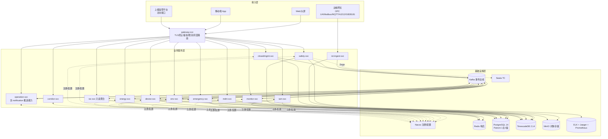
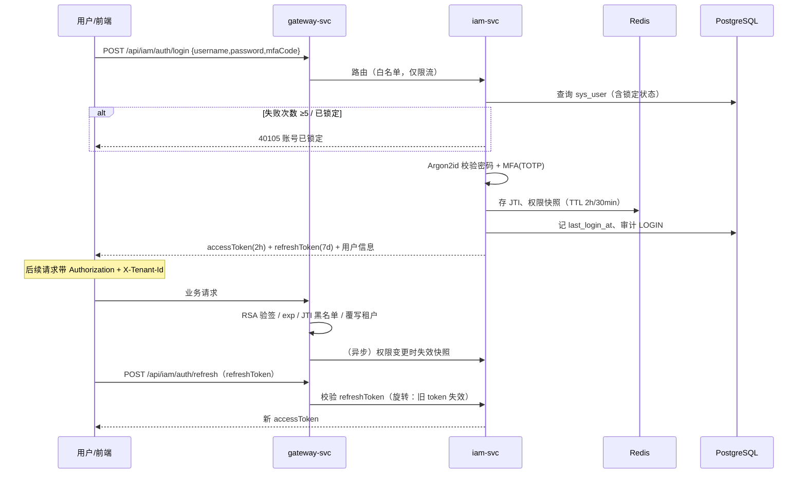
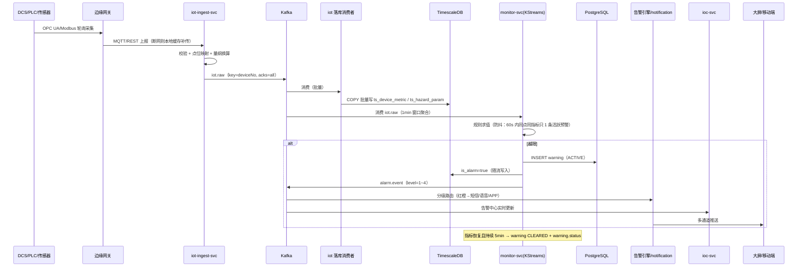
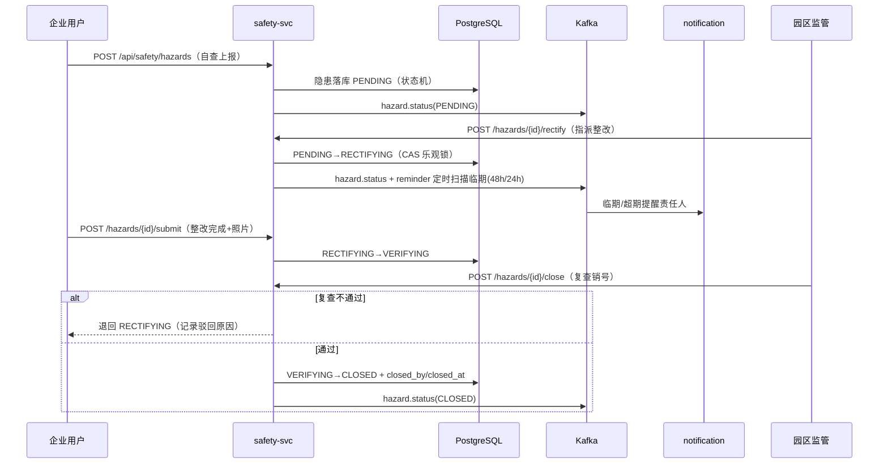
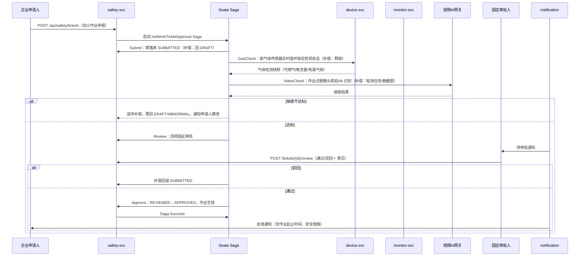
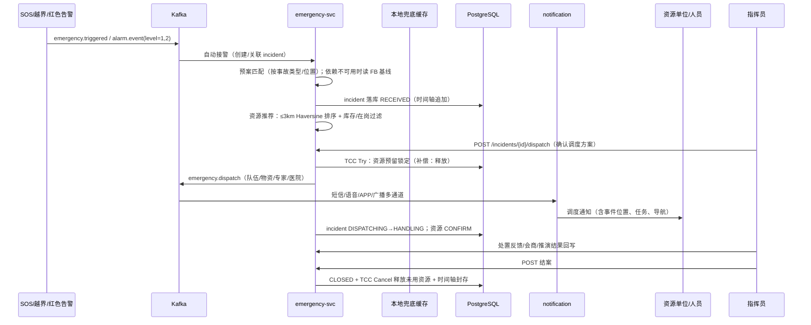
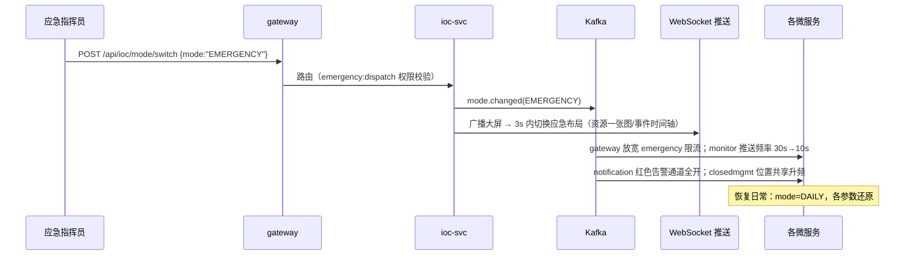
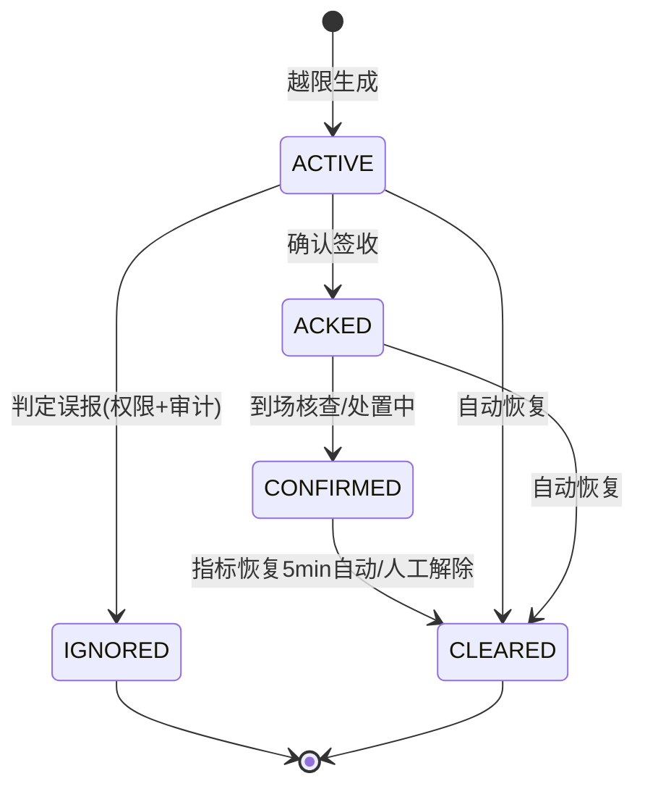
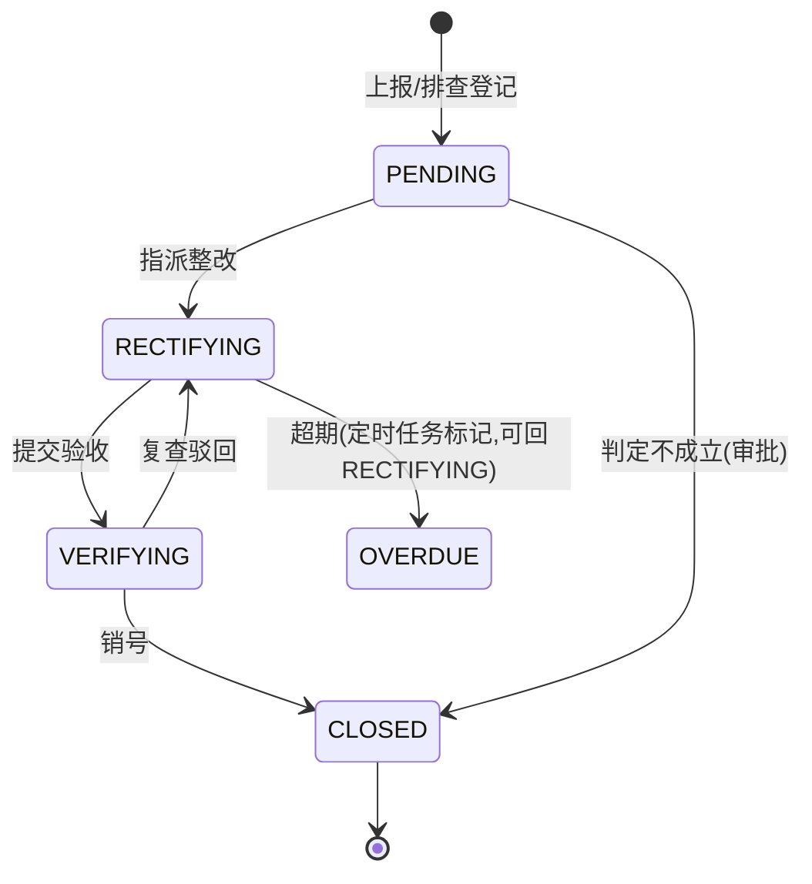
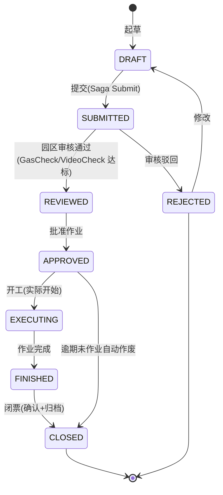

# 详细设计说明书

> **项目名称**：化工园区安全环保一体化智慧管控平台（以下简称"平台"）
> **文档版本**：V2.0（专业深化版）
> **编制日期**：2026-09-02
> **技术基线**：Java 21 / Spring Boot 3.2 / Spring Cloud 2023.x / Kubernetes + Helm
> **配套文档**：《微服务架构设计方案》《数据库设计说明书》《服务接口契约与事件设计》《分布式事务与 Saga 实现示例》《时序数据库表结构设计》《等保三级安全加固检查清单》《应急演练与容灾切换预案》《CI/CD GitLab Pipeline 示例》《Kubernetes-Helm 部署清单示例》《北向接口设计》《物模型技术方案参考》

---

## 目录

1. [文档说明](#1-文档说明)
2. [系统总体设计](#2-系统总体设计)
3. [通用设计约定](#3-通用设计约定)
4. [微服务详细设计](#4-微服务详细设计)
5. [关键业务流程设计（端到端时序）](#5-关键业务流程设计端到端时序)
6. [领域状态机设计](#6-领域状态机设计)
7. [分布式事务与一致性设计](#7-分布式事务与一致性设计)
8. [事件驱动设计（Kafka）](#8-事件驱动设计kafka)
9. [缓存设计](#9-缓存设计)
10. [数据持久化设计](#10-数据持久化设计)
11. [安全设计](#11-安全设计)
12. [可观测性设计](#12-可观测性设计)
13. [容错与降级设计](#13-容错与降级设计)
14. [定时任务与报表设计](#14-定时任务与报表设计)
15. [CI/CD 与部署设计](#15-cicd-与部署设计)
16. [性能设计与容量指标](#16-性能设计与容量指标)
17. [扩展点与演进规划](#17-扩展点与演进规划)
18. [附录](#18-附录)

---

## 1. 文档说明

### 1.1 编制目的

在《微服务架构设计方案》（架构级）与《服务接口契约与事件设计》（契约级）基础上，本文档下沉到**模块内部设计**：明确每个微服务的内部分层、核心组件、关键流程时序、状态机、算法规则、缓存与容错策略，作为开发编码、代码评审、测试用例设计与运维配置的直接依据。

### 1.2 适用范围

覆盖平台全部 14 个微服务、网关与公共中间件（Nacos/Kafka/Redis/PostgreSQL/TimescaleDB/MinIO/Seata）的详细设计；边缘网关与 AI 推理服务仅描述对接边界（详见《物模型技术方案参考》）。

### 1.3 读者对象

| 读者 | 关注章节 |
|------|----------|
| 后端开发工程师 | 第 3~9 章（约定、服务设计、流程、事务、事件、缓存） |
| 前端/大屏开发 | 第 3 章（接口约定）、第 4.14（IOC 聚合）、第 5.6（平急切换） |
| 测试工程师 | 第 6 章（状态机）、第 7 章（一致性）、第 16 章（性能指标） |
| 架构师 / DBA / 运维 | 第 10、12、13、15、16 章 |
| 安全 / 测评人员 | 第 11 章及各服务"安全要点" |

### 1.4 编制依据

- GB/T 22239-2019 等保 2.0 三级要求；《化工园区安全风险智能化管控平台建设指南（试行）》；
- PRD/BRD 性能与功能指标；ADR 架构决策记录；
- Spring Boot 3.x / Spring Cloud 2023.x / TimescaleDB 2.14 / Kafka 3.7 官方技术基线。

### 1.5 术语

| 术语 | 说明 |
|------|------|
| CQRS | 命令查询职责分离；IOC 大屏为只读读模型 |
| Saga | 长事务编排模式，本地事务 + 补偿动作保证最终一致 |
| TCC | Try-Confirm-Cancel 两阶段补偿型事务（资源预留） |
| DLT | Dead Letter Topic，死信队列 |
| WORM | 只追加不可篡改存储（审计日志） |
| 平急模式 | 日常监管模式 ↔ 应急指挥模式，大屏 ≤3s 切换 |

### 1.6 修订记录

| 版本 | 日期 | 修订说明 |
|------|------|----------|
| V1.0 | 2026-08-22 | 初版：模块职责、中间件、接口与事件概述 |
| V2.0 | 2026-09-02 | 全面深化：补全 14 微服务内部设计、端到端时序图、状态机、Saga/TCC 细节、幂等/缓存/容错/可观测/CI/CD/容量；统一技术基线（Nacos 配置中心、Kafka KRaft、Redis 哨兵、服务命名与接口契约文档对齐）；修正 Seata 事务库、报表计算引擎等描述 |

---

## 2. 系统总体设计

### 2.1 设计目标与约束

| 维度 | 目标 | 来源 |
|------|------|------|
| 实时性 | 监测看板 10s 刷新、IOC 大屏 30s 刷新、告警端到端 ≤5s、平急切换 ≤3s、应急调度 ≤5min | PRD |
| 可用性 | 99.9% SLA；RTO ≤30min、RPO ≤5min；主库自动切换 ≤60s | BRD/容灾预案 |
| 一致性 | 主数据强一致；IoT/统计最终一致；跨域审批 Saga 可补偿 | ADR |
| 安全性 | 等保 2.0 三级；TLS 1.3；三员分立；WORM 审计 | 等保清单 |
| 扩展性 | 服务水平扩缩容（HPA）；单园区私有化与 SaaS 多园区双形态 | 架构方案 |

**设计约束**：① 服务间禁止循环调用（ioc-svc 只读不写回业务）；② emergency-svc 对外部调用全部熔断降级 + 本地基线兜底；③ 高频时序写不经过业务库；④ 所有跨服务写操作必须可幂等重试。

### 2.2 架构总览

平台采用"**网关 + 微服务 + 事件总线 + 多引擎存储 + 边缘接入**"五层结构：



### 2.3 技术选型清单

| 层 | 选型 | 版本/说明 |
|----|------|-----------|
| 语言/框架 | Java 21、Spring Boot 3.2、Spring Cloud 2023.x | JDK 21 LTS |
| 注册/配置 | Nacos（注册中心 + 配置中心，≥3 节点 Raft） | 替代 Spring Cloud Config |
| 网关 | Spring Cloud Gateway（WebFlux） | 全局 JWT 过滤器、Sentinel 限流 |
| 服务调用 | OpenFeign + Spring Cloud LoadBalancer | 本地实例缓存 + 熔断 |
| 容错 | Sentinel（限流/熔断/系统自适应保护） | 规则经 Nacos 动态下发 |
| 安全 | Spring Security 6、OAuth2.1 + OIDC、JJWT（RSA-256） | access token ≤2h |
| 持久化 | MyBatis-Plus（主）/ Spring Data JPA（MDM 只读模型可选） | Flyway 管 DDL |
| 数据库 | PostgreSQL 14（Patroni + PgBouncer）、TimescaleDB 2.14 | 详见数据库设计说明书 |
| 缓存 | Redis 7（哨兵模式，大规模可升级 Cluster） | AOF + RDB |
| 消息 | Kafka 3.7（KRaft，3 broker，RF=3，min.insync.replicas=2，acks=all） | RabbitMQ 仅作内部通知兜底 |
| 实时计算 | Kafka Streams（规则匹配/窗口聚合）、Flink（复杂 CEP，按需引入） | |
| 分布式事务 | Seata（Saga 长流程 / TCC 资源预留） | TC 独立部署，事务库与业务库隔离 |
| 工作流/状态机 | Spring Statemachine（隐患/作业票/预警流转）；Flowable（审批流引擎，按需） | |
| 对象存储 | MinIO（EC 纠删码 + 预签名 URL） | |
| 视频/AI | GB/T 28181 视频网关；AI 推理 Python 服务（gRPC） | |
| 可观测 | Micrometer + Prometheus + Grafana、OpenTelemetry + Jaeger、ELK | |
| 构建部署 | Maven、Docker、Harbor、GitLab CI、Kubernetes + Helm | Trivy/SonarQube 质量门 |

### 2.4 服务清单与职责边界

| # | 服务 | 核心职责 | 写库 | 主要消费 Topic | 关键 SLA |
|---|------|----------|------|----------------|----------|
| 1 | gateway-svc | 路由、鉴权、限流、灰度、日志 | — | — | P99 < 50ms 自身开销 |
| 2 | iam-svc | 认证/OIDC、用户角色权限（三级 RBAC）、审计 WORM | PG: mdm/audit | audit.log | 登录 P95 < 500ms |
| 3 | mdm-svc | 园区/企业/危险源/监测点主数据单一真相源、数据资产目录 | PG: mdm | mdm.snapshot 发布 | 强一致 |
| 4 | iot-ingest-svc | 协议适配、清洗校验、点位映射、边缘补传 | PG: iot（点位映射/网关）；时序由独立消费者落 TSDB | iot.raw 生产 | 峰值 2 万行/s |
| 5 | device-svc | 设备台账/健康度/维保、指令下发、心跳 | PG: mdm | iot.raw（状态）、device.command.result | 指令到达 < 3s |
| 6 | safety-svc | 双重预防（风险/隐患）、八大类作业票、一企一档 | PG: safety | iot.raw（联动抽查）、ticket/hazard 事件发布 | 审批不丢单 |
| 7 | monitor-svc | 阈值规则、四级预警、告警引擎、督办 | PG: safety(warning)；TSDB | iot.raw | 告警 ≤5s |
| 8 | closedmgmt-svc | 门禁卡口、UWB 定位、车辆 GPS、电子围栏、SOS | PG: closed；TSDB(轨迹) | iot.raw（定位流） | 越界 ≤3s 上报 |
| 9 | env-svc | 环境质量、HJ212 排口、VOCs、固废联单、溯源 | PG: env；TSDB | iot.raw（环保流） | 超标即时告警 |
| 10 | energy-svc | 能源计量、Scope1/2/3 碳核算、碳配额、能效诊断、源网荷储 | PG: energy；TSDB | iot.raw（能碳流） | 报表 T+1 |
| 11 | corridor-svc | 管廊监控、TDLAS/光纤泄漏、无人机机器人巡检 | PG: corridor | iot.raw（管廊流） | 泄漏即报 |
| 12 | emergency-svc | 预案库、资源一张图、接处警、一键调度、ALOHA/PHAST/FDS 推演 | PG: emergency | emergency.triggered、alarm.event | **最高优先级，降级可用** |
| 13 | operation-svc | 入园审批、政策推送、物流叫号、产业链、OA、经济运行、**notification 多通道推送**（短信/微信/APP/WebSocket） | PG: operation | reminder.event、各通知类 Topic | 推送到达率 > 99% |
| 14 | ioc-svc | 态势一张图、四色图、告警中心聚合、平急模式切换（**CQRS 只读**） | 不写业务库；Redis 读缓存 | alarm.event、warning.status、hazard.status、ticket.status、emergency.* | 大屏 30s 刷新 |

> notification 推送能力在分期建设中可作为 operation-svc 内模块（`notification` 包）独立线程池运行，规模化后拆分为 notification-svc；本文统一以"notification 组件"描述。

### 2.5 服务内部分层规范

所有微服务遵循统一四层结构（包名 `com.chemspark.<svc>`）：

```
controller/     REST 入口：参数校验、鉴权注解、DTO 转换，不写业务逻辑
application/    应用服务：用例编排、事务边界、Saga 发起、事件发布（@Transactional）
domain/         领域层：实体、值对象、领域服务、状态机（Spring Statemachine）、业务规则
infrastructure/ 持久化（MyBatis Mapper/Entity）、Kafka 生产者消费者、Feign 客户端、
                Redis、MinIO、外部网关适配
```

- **依赖方向**：controller → application → domain ← infrastructure（domain 不依赖基础设施，依赖倒置）；
- **DTO 边界**：对外 `xxxVO`/`xxxRequest`，持久层 `xxxDO`，领域内 `xxxEntity`，MapStruct 转换；
- **事务边界**：`@Transactional` 只标注在 application 层；事务内禁止 Feign 调用与消息发送（发消息走事务提交后回调 / 本地消息表）；
- **统一基类**：`BaseEntity`（id/tenantId/createdAt/createdBy/updatedAt/updatedBy/isDeleted/version，见数据库设计说明书 4.6）。

---

## 3. 通用设计约定

### 3.1 统一响应包络与错误码

```json
{
  "code": 0,
  "message": "success",
  "traceId": "a1b2c3d4e5f6",
  "data": { },
  "timestamp": "2026-09-02T10:30:00Z"
}
```

| 错误码段 | 语义 | HTTP 状态 |
|----------|------|-----------|
| 0 | 成功 | 200 |
| 400xx | 参数/校验失败 | 400 |
| 401xx | 未认证 / token 失效 / 无权限 | 401/403 |
| 404xx | 资源不存在 | 404 |
| 409xx | 状态冲突 / 重复提交 / 幂等冲突 | 409 |
| 429xx | 限流 / 熔断降级 | 429 |
| 500xx | 服务内部错误 / 第三方故障 | 500 |

**关键业务错误码**：

| code | 含义 |
|------|------|
| 40001 | 参数缺失/格式错误（含 JSR-303 校验） |
| 40101 | 未登录/token 过期；40103 无权限；40105 账号锁定 |
| 40401 | 业务对象不存在；40404 租户不可见（防枚举，统一 404） |
| 40901 | 隐患状态机非法跃迁 |
| 40902 | 作业票审批冲突（重复审批/状态不符） |
| 40903 | 设备离线，指令无法下发 |
| 40904 | 应急资源已被锁定/库存不足 |
| 40905 | 重复提交（X-Request-Id 命中） |
| 42901 | 触发限流；42902 | 服务降级中返回兜底数据 |

### 3.2 公共请求头与分页

| Header | 必填 | 说明 |
|--------|------|------|
| `Authorization` | 是 | `Bearer {accessToken}`（登录接口除外） |
| `X-Tenant-Id` | 是 | 租户编码；Gateway 从 JWT claims 解析并**覆写**，防伪造 |
| `X-Request-Id` | 否 | 幂等键/链路 ID；未传时网关注入 UUID |
| `Accept-Language` | 否 | zh-CN（默认）/ en-US |
| `X-Canary-Version` | 否 | 灰度版本路由 |

- 分页：`pageNum`（默认 1）、`pageSize`（默认 20，最大 200）、`sort`（如 `createdAt,desc`）；响应 `{ total, pages, pageNum, pageSize, list }`；
- 深分页（>100 页）必须改用 keyset 游标（`?cursor={lastId}&size=20`）；
- 时间字段统一 ISO-8601 UTC（`2026-09-02T10:30:00Z`），数据库存 TIMESTAMPTZ。

### 3.3 多租户上下文

```
HTTP 请求 → Gateway（JWT 解析 tenantId 写入 X-Tenant-Id）
         → TenantFilter（OncePerRequestFilter）：
              校验 Header → TenantContextHolder.set(tenantId)
         → MyBatis-Plus TenantLineHandler 自动改写 SQL（追加 tenant_id 条件）
         → PgBouncer 事务开始 SET app.tenant_id（RLS 兜底，见数据库设计说明书 9.3）
         → finally：TenantContextHolder.clear()
```

- Kafka 消息体必含 `tenantId`，消费者在处理入口重建 `TenantContext`；
- Redis key 统一前缀 `{tenantId}:{module}:...`；MinIO 路径统一 `/{tenantId}/...`；
- 定时任务/内部回调以系统身份执行时显式指定租户集合，禁止"无租户"全量扫描业务表。

### 3.4 幂等设计

| 场景 | 幂等手段 |
|------|----------|
| 写接口（POST） | `X-Request-Id` + Redis SET NX（TTL 10min）；命中返回首次结果，40905 |
| Kafka 消费 | 事件包络 `eventId` 唯一；消费者落 `processed_events(event_id PK)` 表（或 Redis 24h 去重 + DB 唯一约束双保险） |
| IoT 点位 | 业务唯一键 `(tenant_id, device_no, metric, time)`；`INSERT ... ON CONFLICT DO NOTHING` |
| 作业票/审批动作 | 状态机当前态校验（CAS：`UPDATE ... WHERE id=? AND status=?`，影响行数=0 即冲突 40902） |
| 指令下发 | `commandId` 幂等键；边缘网关对同 commandId 只执行一次 |
| 定时任务 | ShedLock（基于 Redis/PG）保证多副本下单实例执行 |

### 3.5 统一异常处理

```java
@RestControllerAdvice
public class GlobalExceptionHandler {
    @ExceptionHandler(BusinessException.class)
    public Result<Void> biz(BusinessException e) { return Result.fail(e.getCode(), e.getMessage()); }
    @ExceptionHandler(MethodArgumentNotValidException.class)  // 40001
    @ExceptionHandler(AccessDeniedException.class)           // 40103
    @ExceptionHandler(FeignException.class)                  // 500xx + 熔断降级由 Sentinel 兜底
    @ExceptionHandler(Exception.class)                       // 50000，记录完整堆栈，对外屏蔽细节
}
```

- 业务异常抛 `BusinessException(ErrorCode, args...)`，禁止 `catch (Exception e) {}` 吞异常；
- Feign 异常不向前端透传第三方细节，转译为 500xx 并记录下游服务名。

### 3.6 审计与操作留痕

- 注解 `@AuditLog(action="WORK_ORDER_APPROVE", objectType="work_order", expr="#id")`，AOP 切面在**事务提交后**异步发送 `audit.log` Topic + 写入 `audit.audit_log`（WORM）；
- 记录内容：操作人、租户、IP、UA、HTTP 方法/URI、参数（手机号/身份证等敏感字段脱敏）、结果、traceId；
- 登录/导出/审批/指令下发/权限变更为强制审计点。

---

## 4. 微服务详细设计

> 每个服务按"职责边界 → 内部分层组件 → 核心流程 → 接口与事件 → 设计要点"描述；REST 接口完整字段见《服务接口契约与事件设计》，表结构见《数据库设计说明书》。

### 4.1 gateway-svc（API 网关）

**职责**：唯一外部入口；TLS 1.3 终止、JWT 校验、租户注入、限流熔断、灰度路由、访问日志、防重放。

**核心过滤器链（顺序）**：

```
TraceFilter      生成/透传 X-Request-Id，MDC 注入 traceId
TlsFilter        强制 https（HSTS），HTTP 308 跳转
AuthFilter       白名单（/api/iam/auth/login、/actuator/health）外校验 JWT：
                   RSA 公钥验签 → exp/iss/aud → JTI 黑名单（Redis 登出）→ 解析 claims
TenantFilter     以 JWT.tenantId 覆写 X-Tenant-Id（防伪造）
IdempotentFilter 对 POST 缓存 X-Request-Id（透传至下游）
RateLimitFilter  Sentinel 网关限流：按租户/IP/路由维度 QPS + 并发
CanaryFilter     X-Canary-Version / 用户尾号 → 灰度服务实例（Nacos metadata）
AccessLogFilter  Logbook 结构化访问日志 → ELK
```

**设计要点**：
- 路由表来自 Nacos 服务发现：`/api/{service}/**` → `lb://{service}-svc`；
- 限流规则：认证接口 5 QPS/IP、登录失败 5 次锁定（iam 侧）、全局租户级 2000 QPS；
- 网关自身无状态、≥2 副本 + HPA（CPU 60%）；`emergency-svc` 路由标记最高优先级，紧急态下 Sentinel 限流阈值自动放宽（订阅平急模式事件）。

### 4.2 iam-svc（统一身份与权限）

**职责**：OAuth2.1 + OIDC 认证、三级 RBAC（模块/功能/数据级）、三员分立、MFA、审计 WORM。

**内部组件**：

| 组件 | 说明 |
|------|------|
| AuthController | `/api/iam/auth/login|refresh|logout` |
| TokenService | RSA-256 JWT 签发：access TTL 2h、refresh TTL 7d；JTI 写 Redis（登出即删） |
| UserDetailsService | 本地账号（Argon2id 校验）+ LDAP/AD 适配（园区既有目录） |
| PermissionService | 角色-权限聚合，登录时加载权限快照 → Redis `{tenant}:iam:perms:{userId}`（TTL 30min，变更主动失效） |
| DataScopeResolver | 数据级权限：1 全区 / 2 本企业 / 3 本人，翻译为 SQL 过滤条件（enterprise_id / created_by） |
| AuditProducer | 审计切面落 `audit.audit_log` + 发 `audit.log` |
| MfaService | TOTP/短信二次验证（admin、应急指挥角色强制开启） |

**登录时序**见 [5.1](#51-登录与令牌刷新)。

**设计要点**：
- 密码策略：长度 ≥8、大小写+数字+特殊字符、90 天强制改密提醒、连续 5 次失败锁定 30min（`fail_count`/`locked_until`）；
- 三员分立：系统管理员（dba/用户管理）、安全保密管理员（secadmin/策略配置）、安全审计员（auditor/审计只读）互斥，角色互斥在授权时校验；
- 越权防护：`@PreAuthorize("@perm.check('safety:workorder:approve')")` + DataScope 行级过滤，全部服务端校验。

### 4.3 mdm-svc（主数据管理）

**职责**：园区、企业、重大危险源、传感器/监测点主数据的**单一真相源**；数据资产目录。

**内部组件**：
- `EnterpriseService`：一企一档（工商信息、证照、危化品登记、风险四色定级）；证照临期扫描；
- `HazardService`：重大危险源登记与 R 值分级（L1~L4），`chemicals` JSONB 存危化品清单；
- `SnapshotPublisher`：主数据变更后发 `mdm.snapshot`（UPSERT/DELETE），各域消费维护本地只读副本；
- `ImportService`：Excel 批量导入（企业/设备），逐行校验 + 错误报告回传 MinIO。

**设计要点**：
- 主数据写操作低频强一致：本地事务提交后通过**事务事件**（`@TransactionalEventListener(AFTER_COMMIT)`）发布快照，避免"库改了消息没发"；
- 消费端（device/monitor 等）以快照表 Upsert 本地读模型，跨服务查询不实时 Feign 调 mdm，防止主数据服务拖垮高频链路；
- 软删除：`is_deleted`；删除主数据前 RESTRICT 校验关联设备/危险源（外键约束，见数据库设计说明书 5.2）。

### 4.4 iot-ingest-svc（采集接入）

**职责**：协议适配（OPC UA/Modbus/MQTT/HJ212/GB28181）、报文校验清洗、点位映射、写入 Kafka；边缘断网补传。

**内部组件**：

| 组件 | 说明 |
|------|------|
| ProtocolAdapter | 各协议监听器（MQTT topic `iot/{tenantId}/{deviceNo}`、HJ212 TCP Server、REST `/api/iot/points/ingest`） |
| MessageValidator | JSON Schema + 点位映射校验（deviceNo/metric 白名单、量纲换算 scale/offset、质量码映射） |
| PointMappingCache | 点位映射表本地缓存（Caffeine，订阅 mdm.snapshot 刷新） |
| KafkaProducer | 攒批发送 `iot.raw`，key=`deviceNo`（保序），acks=all，重试 5 次 |
| DeadLetterHandler | 校验失败/投递失败 → `iot.deadletter`（含原始报文、原因），运维台可重放 |
| EdgeSyncService | 边缘网关注册、双向证书校验、断网补传窗口合并（按 time 去重） |

**设计要点**：
- 边缘网关本地 SQLite/文件缓存断网数据，恢复后按时间序补传；ingest 侧以 `(device_no, metric, time)` 幂等吸收重复；
- 写入路径无外部依赖：映射查不到的点位直接进死信，不阻塞主管道；
- 时序落库由独立消费者批量 `COPY` 到 TimescaleDB（批 5,000~20,000 行），ingest 服务不直连时序库写。

### 4.5 device-svc（设备管理）

**职责**：设备/传感器全生命周期台账、在线状态、健康度、维保、远程指令下发与回执。

**核心机制**：

- **心跳与在线状态**：边缘网关每 30s 上报心跳 → `device.heartbeat`（内部 topic）→ 更新 Redis `{t}:dev:online:{deviceNo}`（TTL 90s，两次心跳未续期即离线）→ 状态变更异步落库 `online_status`；
- **健康度评分**：`health = 100 - 故障次数×10 - 离线时长扣分 - 维保超期扣分`，由定时任务每小时计算（近 30 天窗口）；
- **指令下发时序**见 [5.5 关联流程](#5-关键业务流程设计端到端时序)；指令体 HMAC-SHA256 签名（密钥按网关分发），`commandId` 幂等，超时 60s 未回执标记 `TIMEOUT` 并告警；
- **指令状态机**：`CREATED → SENT → ACKED → EXECUTING → SUCCESS/FAILED/TIMEOUT`。

### 4.6 safety-svc（安环管理：双重预防 + 作业票）

**职责**：风险分级管控（红橙黄蓝）、隐患排查治理闭环、八大类特殊作业票审批、一企一档。

**内部组件**：

| 组件 | 说明 |
|------|------|
| RiskService | 风险点 LS/LEC 评分：R=L×S → 四色分级；管控措施与责任人 |
| HazardService | 隐患登记/整改/复查/销号状态机；临期 48h/24h、超期扫描发 `reminder.event` |
| TicketService | 作业票申报、审批链（Flowable/状态机）、气体检测联动、联合抽查编排 |
| JointCheckClient | Feign 调 device-svc（气体传感器实时值）、monitor-svc（阈值状态）、视频 AI 网关（现场抓拍），Sentinel 降级 |
| SagaOrchestrator | 发起作业票审批 Saga（见 [7.2](#72-saga-作业票审批)） |
| ProfileService | 一企一档聚合（本域 + 订阅 mdm/monitor/env 快照） |

**隐患状态机**与**作业票状态机**见第 6 章；作业票审批 Saga 时序见 [5.4](#54-作业票审批-saga)。

**设计要点**：
- 状态跃迁全部走 Spring Statemachine 持久化配置，非法跃迁返回 40901/40902；
- 作业票有效期校验：`planned_end` 到期未闭环自动提醒，超期未作业自动作废（定时任务 + 状态机事件）；
- 审批链 `approver_chain` JSONB 记录每节点审批人/意见/时间/签名，支持驳回退回指定节点。

### 4.7 monitor-svc（重大危险源监测预警）

**职责**：阈值规则管理、实时流计算、四级预警生成与升级、督办核查。

**内部组件**：

| 组件 | 说明 |
|------|------|
| RuleService | 阈值规则 CRUD（target+metric+四档阈值+启用开关），规则热加载到计算拓扑 |
| StreamProcessor | Kafka Streams：消费 `iot.raw`，按 `(hazardId/deviceNo, metric)` 分组，1min 滚动窗口聚合（avg/max） |
| RuleEvaluator | 窗口结果 × 规则求值（支持 AND/OR 复合、`avg(metric,5m)>x` 窗口表达式），越限 → 生成预警 |
| WarningService | 预警落库 `warning`（状态机）+ 写时序 `ts_hazard_param.is_alarm=true` + 发 `alarm.event` |
| EscalationService | 超时未确认升级：红/橙/黄/蓝分别 0/30min/2h/记录；升级发新级别 alarm 并通知上级 |
| VerifyService | 督办：指派核查人、填报核查结果、关联处置照片 |

**告警链路时序**见 [5.2](#52-iot-采集告警通知全链路)。

**设计要点**：
- 独立读写库连接：写预警走主库，看板/历史走备库 + 连续聚合视图（`v_hazard_param_1m`），10s 刷新不被低频查询拖累；
- 防抖：同一 (target, metric) 在 60s 内重复越限只产生一条活跃预警（Redis NX 锁 + 活跃预警查询）；
- 预警恢复：指标回到阈值内并持续 5min，自动 `CLEARED`（发 `warning.status`）。

### 4.8 closedmgmt-svc（封闭化与人员定位）

**职责**：门禁卡口、访客预约、人员 UWB/蓝牙定位、危化品车辆 GPS、电子围栏、SOS、区域人数统计。

**核心机制**：

- **定位流**：UWB/GPS 数据经 iot-ingest → `iot.raw`（obj 维度）→ 消费者批量写 `ts_location_track`；最新位置写 Redis `{t}:loc:person:{personId}`（TTL 10s）供实时查询；
- **电子围栏**：围栏多边形（GeoJSON）由定位流处理线程做射线法点在多边形内判定（预加载 + 本地缓存，围栏数 < 万级无需 PostGIS）；进入禁限区 → `fence_breach=true` → 发 `alarm.event`（FENCE 类型）；车辆偏离路线同理；
- **区域人数**：查最近 1min 轨迹 `count(distinct obj_id) group by zone`（见数据库设计说明书 7.6④），结果缓存 Redis TTL 5s；
- **SOS**：`POST /api/closed/persons/sos` → 立即发 `emergency.triggered`（triggerType=SOS，含位置）+ 推送安保。

**设计要点**：定位轨迹写入量最大（约 5,000 万行/日），仅走时序库；业务库只存围栏/访客/出入记录。

### 4.9 env-svc（环保监管）

**职责**：大气/水质/噪声/VOCs 监测、HJ212 排口监管、超标判定与溯源、固废转移联单。

**核心机制**：
- HJ212 报文经 iot-ingest 适配（MN 号 → point_id）落 `ts_env_monitor`；
- 超标检测：Kafka Streams 5min 窗口均值 vs `std_limit` → 越限 `is_over=true` + 发 `alarm.event`（ENV_OVER）+ notification 推送短信/企业微信；
- **污染溯源**：`source-trace` 按排口上下游关系 + 风向 + 企业生产时段（operation 排程快照）做关联排序，输出疑似贡献企业列表；
- 固废联单：创建→转移→接收状态流转；超 90 天未闭环发 `reminder.event`。

### 4.10 energy-svc（能碳管理）

**职责**：多能源计量、Scope1/2/3 碳核算、碳配额管理、能效诊断、源网荷储状态。

**核心算法/规则**：

- 碳排计算：`碳排 = Σ(能源消耗量 × 排放因子)`，因子表 `energy_factor(energy_type, factor, year)` 可配置；电力使用区域电网年度因子；
- 聚合来源：`v_energy_1h` 连续聚合（小时能耗/功率/碳当量）→ 日/月/年报表 rollup；
- 碳配额：`结余 = 配额 allocated - 已用 used`，使用率 > 90% 预警；
- 能效诊断：单位产品能耗对标行业基准，偏差 > 15% 输出节能建议（规则库 + 同期对比）。

### 4.11 corridor-svc（管廊设施）

**职责**：管廊监控、TDLAS 气体泄漏/光纤温度监测、无人机/机器人巡检任务与结果。

**核心机制**：
- 管廊传感器经 iot-ingest 接入（泄漏、温度、液位），越限发 `alarm.event`（类别 SAFETY，subType=CORRIDOR_LEAK）；
- 巡检：任务创建（计划/手动）→ 下发无人机机库/机器人（device-svc 指令通道）→ 回传图片/视频/识别结果（AI 网关 gRPC）→ 隐患自动转 safety-svc 隐患登记（发内部事件，safety 消费建档）。

### 4.12 emergency-svc（应急指挥）

**职责**：数字化预案库、应急资源一张图、接处警、一键调度、多方会商、事故模拟推演（ALOHA/PHAST/FDS 适配）。**平急结合，应急链路最高优先级且可降级独立运行**。

**内部组件**：

| 组件 | 说明 |
|------|------|
| PlanService | 预案版本化（草稿/审核/发布/废止）；`summary` 存结构化基线（处置步骤、资源清单、联系人）供断依赖时本地兜底 |
| IncidentService | 接处警登记、事件状态机、处置时间轴 |
| TriggerConsumer | 消费 `emergency.triggered`（SOS/越界）与高级别 `alarm.event`（红/橙自动接警） |
| DispatchService | 一键调度：资源推荐（≤3km，Haversine 距离排序 + 库存过滤）→ TCC 锁定资源 → 发 `emergency.dispatch`（notification 多通道：短信/语音/APP/广播） |
| ConferenceService | 多方会商（视频会议网关适配 + 消息房间） |
| SimulationService | ALOHA/PHAST/FDS 模型适配（异步任务 → 结果回写 → `simulation.result` → 大屏影响范围/疏散路线） |
| FallbackStore | Caffeine 本地缓存预案基线与资源快照（定时刷新，TTL 24h），下游不可用时只读兜底 |

**应急触发调度时序**见 [5.5](#55-应急触发与一键调度)。

**设计要点**：
- 对 iam/mdm/device/closedmgmt 的 Feign 调用全部 Sentinel 熔断（超时 1s），失败读 `FallbackStore`；
- 资源锁定用 TCC（见 [7.3](#73-tcc-应急资源锁定)），事件结束/取消释放；
- 事件时间轴只追加：接警、调度、到达、处置、会商、结案全部入时间轴表，支撑事后复盘与审计。

### 4.13 operation-svc（园区运营 + 通知组件）

**职责**：入园审批、政策精准推送、危化品车辆叫号、危化品仓库、产业链协同、OA 公文、经济运行；**notification 多通道推送组件**。

**notification 组件设计**：

```
消费 alarm.event / emergency.dispatch / reminder.event / hazard.status / ticket.status
  → NotifyRouter（按订阅规则：角色/企业/级别 → 通道映射）
  → ChannelSender：短信（运营商网关）、企业微信/钉钉 webhook、APP PUSH（绑定设备令牌）、
                   WebSocket（大屏/桌面）、语音（应急）
  → 发送结果落 notify_record（重试用指数退避，最多 3 次；失败入人工补偿台）
```

- 订阅规则可配置（Nacos）：红色告警 → 语音+短信+APP+大屏全通道；蓝色 → 仅 APP/大屏；
- WebSocket 连接按租户+用户鉴权，心跳 30s，集群下用 Redis Pub/Sub 跨节点广播。

### 4.14 ioc-svc（智能运营中心，CQRS 读侧）

**职责**：综合态势一张图、安全风险四色图、实时告警中心、多维统计、平急模式切换；**只读写模型，不反向写业务库**。

**数据组装策略**：

| 数据 | 来源 | 刷新 |
|------|------|------|
| 实时指标曲线 | 时序连续聚合视图（v_*_1m/5m/1h） | 10~30s 轮询/WebSocket 推送 |
| 告警列表/统计 | 订阅 `alarm.event`/`warning.status` 内存聚合 + Redis 快照 | 实时 |
| 四色图/企业风险 | 订阅 `mdm.snapshot` 本地读模型 | 变更驱动 |
| 应急态势 | 订阅 `emergency.*` | 实时 |
| 统计报表 | Feign 拉取各域摘要（Sentinel 熔断，失败返回上次缓存） | 5min |

**平急模式**：`POST /api/ioc/mode/switch`（应急角色权限）→ 发内部事件 → 大屏 WebSocket 广播模式 → 各服务订阅后调整资源优先级（gateway 放宽 emergency 限流、monitor 提高推送频率），切换 ≤3s。

---

## 5. 关键业务流程设计（端到端时序）

### 5.1 登录与令牌刷新



### 5.2 IoT 采集→告警→通知全链路



### 5.3 隐患排查治理闭环



### 5.4 作业票审批 Saga



> Saga 状态机 JSON 定义、补偿幂等与异常重试策略详见《分布式事务与 Saga 实现示例》。

### 5.5 应急触发与一键调度



### 5.6 大屏平急模式切换



---

## 6. 领域状态机设计

状态机统一用 Spring Statemachine 持久化（状态存业务表，跃迁事件带幂等键），非法跃迁返回 40901/40902。

### 6.1 预警 warning（monitor-svc）



- 升级规则：红立即、橙 30min 未确认升红、黄 2h 未确认升橙；升级 = 发新级别 `alarm.event` 并通知上级；
- 每次跃迁发 `warning.status`，IOC/审计订阅。

### 6.2 隐患 hidden_danger（safety-svc）



### 6.3 作业票 work_order（safety-svc）



### 6.4 预案与应急事件（emergency-svc）

- 预案：`DRAFT → APPROVING → PUBLISHED → DEPRECATED`（新版本发布时旧版本自动 DEPRECATED，保留历史）；
- 应急事件：`RECEIVED → DISPATCHING → HANDLING → CLOSED`（任意环节可挂起 `SUSPENDED` 等待外部信息，恢复后继续）。

### 6.5 设备生命周期（device-svc）

`INSTALLED(投用) → ONLINE ⇄ OFFLINE → MAINTENANCE(维保) → DECOMMISSIONED(报废)`；在线/离线由心跳自动驱动，维保/报废由工单驱动，报废设备保留台账但拒绝新指令（40903 离线/作废语义合并返回）。

---

## 7. 分布式事务与一致性设计

### 7.1 一致性分级与方案选型

| 业务场景 | 一致性 | 方案 |
|----------|--------|------|
| 单服务内写操作（隐患/票/预警落库） | 强一致 | 本地事务（@Transactional） |
| 主数据变更 → 各域读模型 | 最终一致 | `mdm.snapshot` 事件 + 幂等 Upsert + 定时对账 |
| 作业票审批长流程（跨 device/monitor/视频/人工） | 最终一致、可补偿 | **Seata Saga**（每步带补偿） |
| 应急资源锁定/调度 | 强预留语义 | **Seata TCC**（Try 预留 / Confirm / Cancel 释放） |
| IoT 点位落库 | 最终一致、可重传 | Kafka 至少一次 + 业务键幂等 |
| 库改 + 发消息 | 原子性 | 事务提交后事件（AFTER_COMMIT）或本地消息表 |

### 7.2 Saga（作业票审批）

- 状态机：`Submit → GasCheck → VideoCheck → Review → Approve`，每节点声明 `CompensateState`（详见《分布式事务与 Saga 实现示例》JSON 定义）；
- 失败策略：业务异常（可恢复）→ Seata 按重试次数指数退避重试；不可恢复 → 逆序补偿；人工审核节点挂起等待回调，超时（默认 24h）自动补偿退回；
- 补偿幂等：每个补偿动作以 `sagaId + stepName` 在 `saga_instance_log` 去重，重复执行安全；
- 与业务状态机配合：Saga 补偿只驱动状态回退，业务校验仍以状态机 CAS 为准。

### 7.3 TCC（应急资源锁定）

| 阶段 | 动作 |
|------|------|
| Try | `resource` 表冻结字段 `frozen_qty += need`（`WHERE total_qty - frozen_qty >= need`，影响行数 0 → 40904）；锁记录写 `resource_lock`（incidentId, TTL 2h） |
| Confirm | 调度实际消耗：`frozen_qty -= need; used_qty += need`，删除锁记录 |
| Cancel | `frozen_qty -= need` 释放；锁 TTL 到期由定时任务兜底释放（防悬挂） |
| 防悬挂/空回滚 | `tcc_log(xid, branchId, action)` 记录，Cancel 先于 Try 到达时插入空回滚标记，Try 再到达直接放弃 |

### 7.4 事件消费可靠性

- 生产者：`acks=all` + 重试 + 幂等生产者（`enable.idempotence=true`）；
- 消费者：手动提交 offset，**先落库/处理成功再提交**；`max.poll.records` 按批处理能力配置；
- 重试：消费异常 Spring Retry 3 次（指数退避）→ 仍失败进 `*.DLT`，告警台人工重放；
- 顺序：同一 `deviceNo/refId/incidentId` 落同一分区（key 一致），单分区单消费者线程保证有序；
- 对账：每日定时任务核对 mdm 快照版本与各域读模型、warning 与时序 is_alarm 计数，差异自动重放事件并告警。

---

## 8. 事件驱动设计（Kafka）

### 8.1 Topic 总览

| Topic | 生产者 | 消费者 | 分区/保留 | 分区键 |
|-------|--------|--------|-----------|--------|
| `iot.raw` | iot-ingest | 落库消费者/monitor/env/energy/device/closed | 12 / 7d | deviceNo |
| `iot.deadletter` | iot-ingest | 运维台（重放） | 3 / 30d | deviceNo |
| `alarm.event` | monitor/env/closed/corridor | notification/ioc/emergency/告警引擎 | 6 / 30d | refId |
| `warning.status` | monitor | ioc/safety（督办） | 3 / 30d | warningId |
| `emergency.triggered` | closed/monitor/safety | emergency/notification/ioc | 3 / 30d | incidentKey |
| `emergency.dispatch` | emergency | notification/closed/通信网关 | 3 / 14d | incidentId |
| `hazard.status` | safety | ioc/mdm 统计/notification | 3 / 30d | hazardId |
| `ticket.status` | safety | ioc/device（气体联动） | 3 / 30d | ticketId |
| `resource.lock` | emergency | emergency 自身/audit | 3 / 14d | resourceId |
| `mdm.snapshot` | mdm | 全部业务域读模型 | 3 / 7d | entity+id |
| `reminder.event` | safety/env/iam | notification | 3 / 14d | bizId |
| `audit.log` | 所有服务 | ELK/审计 | 6 / 365d | userId |
| `simulation.result` | emergency | ioc | 3 / 30d | simId |
| `mode.changed` | ioc | 全服务 | 1 / 7d | — |

### 8.2 事件包络与 Schema 演进

```json
{
  "eventId": "evt_20260902_a1b2c3",
  "eventType": "ALARM_RAISED",
  "source": "monitor-svc",
  "tenantId": "park_001",
  "occurredAt": "2026-09-02T10:30:00Z",
  "traceId": "trace-xxx",
  "payload": { }
}
```

- **向后兼容**：只允许新增字段（带默认值），禁止改字段语义/删字段；消费方忽略未知字段；
- 破坏性变更发新 Topic（`alarm.event.v2`），双跑一个发布周期后下线旧 Topic；
- 契约测试：事件 Schema 经 JSON Schema 校验纳入 CI（生产者/消费者双方）。

### 8.3 消费者组规范

- 组名 `{svc}-{purpose}`（如 `ioc-alarm-agg`、`emg-trigger`）；不同消费诉求独立组，互不影响 offset；
- 消费者线程数 ≤ 分区数；时序落库消费者可多副本分区再均衡；
- 消费滞后 Lag > 10 万条或延迟 > 60s 触发 Prometheus 告警。

---

## 9. 缓存设计

### 9.1 Redis 数据规划（哨兵模式，AOF + RDB）

| Key 模式 | 数据 | TTL | 写/失效策略 |
|----------|------|-----|-------------|
| `{t}:iam:perms:{userId}` | 权限快照 | 30min | 权限变更主动删 |
| `{t}:iam:jti:{jti}` | 令牌在线标记 | 2h | 登出删除 |
| `{t}:dev:online:{deviceNo}` | 在线状态/心跳 | 90s | 心跳续期 |
| `{t}:loc:person:{personId}` | 人员最新位置 | 10s | 定位流覆盖写 |
| `{t}:loc:zone-count` | 区域人数 | 5s | 定时刷新 |
| `{t}:ioc:dash:{type}` | 大屏聚合结果 | 10~30s | 查询未命中回源并回填 |
| `{t}:warn:active:{target}:{metric}` | 告警防抖锁 | 60s | NX |
| `{t}:mdm:dict:*` | 字典/主数据热点 | 10min | mdm.snapshot 失效 |
| `{t}:lock:shedlock:*` | 定时任务分布式锁 | 任务周期 | ShedLock |

### 9.2 缓存模式与防护

- **Cache-Aside**：读未命中 → 回源 DB → 回填；写操作**先更新库、再删除缓存**（不先删后读，避免回填旧值）；
- **防击穿**：热点 key 回源加分布式锁（单飞），只允许一个请求回源；
- **防雪崩**：TTL 基础值 ±20% 随机抖动；大屏缓存逻辑过期 + 异步刷新；
- **防穿透**：不存在对象缓存空值（短 TTL 30s）+ 参数校验拦截非法 ID；
- 大屏/看板允许秒级延迟，一律读缓存或连续聚合，不直接扫原始超表；
- emergency-svc 另设进程内 Caffeine 兜底缓存（预案/资源基线），Redis 不可用时仍可读。

---

## 10. 数据持久化设计

详细表结构、字段字典、索引、分区、压缩、RLS、备份恢复见《数据库设计说明书》V2.0，本节仅列服务侧设计约束：

- **Schema 属主**：服务只写自有 Schema（mdm/safety/env/energy/closed/corridor/emergency/iot/audit），跨域读走 Feign 或只读账号；
- **访问层**：MyBatis-Plus Mapper + 租户插件 + 逻辑删除插件 + 乐观锁插件（version）；禁止 XML 中写死跨 Schema 关联；
- **连接池**：HikariCP，每服务最大 10~20 连接，经 PgBouncer（transaction 模式）连接数据库；
- **时序访问**：JdbcTemplate 批量 `COPY` 写入；查询必须带 `time` 谓词（chunk 裁剪）与租户条件；
- **DDL 变更**：Flyway 脚本同仓管理，PR 经 DBA 评审，生产用 migrator 账号执行后回收（见数据库设计说明书第 11 章）；
- **大字段**：照片/报告/视频落 MinIO，库内只存路径（`photo_urls`/`file_url` JSONB）。

---

## 11. 安全设计

| 控制项 | 设计 |
|--------|------|
| 传输 | 外部 TLS 1.3（Gateway/Ingress 终止）；服务间 mTLS；Kafka TLS+SASL/SCRAM；数据库 hostssl；边缘网关双向证书 |
| 认证 | OAuth2.1 + OIDC；access JWT 2h / refresh 7d 旋转；MFA（admin/应急角色强制）；移动端 PUSH 令牌绑定设备，注销即失效 |
| 授权 | 三级 RBAC（模块/功能/数据级 DataScope）；`@PreAuthorize` 服务端强制；三员角色互斥 |
| 租户隔离 | Gateway 覆写租户头 → MyBatis 租户插件 → PG RLS 三层；Redis/MinIO key 前缀隔离 |
| 注入防护 | MyBatis 预编译（禁字符串拼接 SQL）；输入校验 JSR-303；文件上传白名单 + 病毒扫描；WAF |
| 存储加密 | 密码 Argon2id；手机号/身份证/法人电话/MFA 密钥 AES-256-GCM 字段加密；存储卷加密（TDE 等效）；密钥 KMS 管理年度轮换 |
| 审计 | `@AuditLog` AOP → audit.audit_log WORM（触发器禁改删）+ audit.log → ELK；留存 ≥6 月（关键 ≥1 年）；traceId 关联 |
| 接口防护 | 防重放（X-Request-Id + 时间戳）；登录 5 次锁定；Sentinel 限流；越权测试纳入 CI |
| 容器安全 | 非 root、只读根文件系统、readiness/liveness 探针、Trivy 镜像扫描阻断高危、NetworkPolicy 默认拒绝 |
| 个人信息 | 定位/人脸最小化采集、脱敏展示、授权同意；测试环境仅用脱敏数据 |

---

## 12. 可观测性设计

### 12.1 三大支柱

| 支柱 | 实现 | 规范 |
|------|------|------|
| Logs | Logback JSON → Logstash → Elasticsearch | 必含 traceId/spanId/tenantId/userId/svc；ERROR 全堆栈；敏感字段脱敏 |
| Metrics | Micrometer → Prometheus → Grafana | RED（率/错误/延迟）+ JVM + 业务指标（告警数、Saga 失败、消费 Lag、设备在线率） |
| Traces | OpenTelemetry Agent → Jaeger | 跨 HTTP/Feign/Kafka 传播 traceId；慢链路（>1s）采样保留 |

### 12.2 关键告警规则（应用侧）

| 指标 | 警告 / 严重 |
|------|-------------|
| 服务 5xx 率 | >1% / >5%（持续 5min） |
| 接口 P95 延迟 | > 1s / > 3s |
| Pod 重启/OOMKilled | 1 次 / CrashLoop |
| Kafka 消费 Lag | > 1 万 / > 10 万 |
| Saga 失败/补偿次数 | > 0 即通知责任人 |
| 告警端到端延迟（iot.raw→alarm.event） | > 5s |
| 定时任务未执行（ShedLock 心跳） | 错过 1 个周期 |
| 备份失败 / 复制延迟 > 30s | 立即 P1（见数据库设计说明书 12.4） |

### 12.3 健康检查

- `/actuator/health/liveness`（存活，重启依据）与 `/actuator/health/readiness`（就绪，摘流量依据）分离；
- readiness 聚合 DB/Redis/Kafka 依赖状态；依赖故障时摘流但不重启（配合降级）。

---

## 13. 容错与降级设计

### 13.1 Sentinel 规则基线

| 资源 | 规则 |
|------|------|
| gateway 全局 | 租户 2000 QPS；登录 5 QPS/IP；突发排队等待 200ms |
| Feign 调用 | 慢调用比例 >50%（RT>1s）熔断 10s；错误比例 >30% 熔断 |
| emergency 出站调用 | 超时 1s，熔断后走 Fallback（本地基线） |
| ioc 聚合调用 | 超时 2s，失败返回 Redis 上次缓存（stale-while-revalidate） |
| 时序写入消费者 | 信号量隔离，批处理线程池独立，避免拖垮 Web 线程池 |

### 13.2 降级矩阵

| 故障 | 降级行为 |
|------|----------|
| Redis 不可用 | 权限快照转本地缓存（TTL 延长）、大屏直接查备库/连续聚合；emergency 读 Caffeine |
| Kafka 不可用 | IoT 边缘 + ingest 本地缓冲（磁盘队列），恢复后补传；实时告警延迟，业务写操作不受影响 |
| 时序库不可用 | 大屏切换最近缓存值并提示"数据延迟"；monitor 预警基于 Kafka 流内存计算继续（状态落 PG 告警表） |
| mdm-svc 不可用 | 各服务读本地快照副本；主数据写入口暂停（明确提示） |
| 下游服务不可用 | emergency 调度走本地预案基线 + 最近资源快照，事后对账补录 |
| 视频 AI 不可用 | 作业票联合抽查转人工现场确认（流程允许跳过节点并记录） |

### 13.3 边缘容灾

边缘网关断网本地缓存采集数据（≥72h），恢复后按时间序补传，ingest 幂等去重；门禁/黑名单在边缘保留最小可用子集，断网仍可拦截。

---

## 14. 定时任务与报表设计

| 任务 | 调度 | 锁 | 说明 |
|------|------|----|------|
| 隐患临期/超期扫描 | 每日 08:00 + 每小时 | ShedLock | 48h/24h 临期提醒、超期标记 + reminder.event |
| 作业票到期处理 | 每 10min | ShedLock | APPROVED 超 planned_end 未开工自动作废提醒 |
| 设备健康度计算 | 每小时 | ShedLock | 近 30 天在线率/故障/维保 |
| 预警超时升级 | 每 1min | ShedLock | 橙 30min/黄 2h 未确认升级 |
| 资源锁 TTL 兜底释放 | 每 5min | ShedLock | TCC 防悬挂 |
| 证照临期提醒 | 每日 09:00 | ShedLock | 企业证照 30 天临期 |
| 能碳日报/月报 | T+1 02:00 | ShedLock | 连续聚合 rollup → 报表文件 MinIO |
| 告警/环保统计报表 | T+1 / 月 | ShedLock | iText/PDF、POI/Excel → MinIO `reports/{tenant}/` + 消息通知 |
| 数据对账 | 每日 03:00 | ShedLock | mdm 快照 vs 读模型；warning vs 时序计数 |
| 时序归档 | 每日 01:00 | ShedLock | 到期 chunk 导出 Parquet/CSV 加密传 MinIO 后 DROP（见数据库设计说明书 7.5） |

- 任务统一用 ShedLock（锁存 PG/Redis）保证多副本单实例执行；任务执行结果发指标（成功/失败/耗时），错过周期告警；
- 报表生成异步化：接口只触发/查询，文件生成走任务线程池，完成后通知下载（预签名 URL，5min 有效）。

---

## 15. CI/CD 与部署设计

### 15.1 GitLab Pipeline 阶段

```
checkout → build(Maven 打包/单测) → test(集成测试 + SonarQube 质量门)
→ package(Docker 镜像 → Harbor) → scan(Trivy 镜像/依赖高危阻断)
→ deploy-dev(Helm upgrade) → verify(冒烟 + Prometheus 5xx/延迟检查)
→ deploy-staging(手动) → deploy-prod(手动批准 + Canary)
```

- 数据库迁移：`deploy-*` 阶段先执行 Flyway `migrate`（migrator 账号），再滚动应用；迁移失败即中止并告警；
- 生产发布：Canary（10% 流量，灰度头 `X-Canary-Version`）观察 30min → 全量；verify 失败自动 `helm rollback`；
- 质量门：单测覆盖率 ≥ 60%（核心域 ≥ 70%）、Sonar 阻断级漏洞 0、Trivy HIGH/CRITICAL 0。

### 15.2 部署与资源基线（生产，摘要）

| 工作负载 | 副本 | 资源（req/limit） | 扩缩 |
|----------|------|-------------------|------|
| gateway-svc | 2+ | 0.5C1G / 1C2G | HPA CPU 60% |
| iam/mdm/safety/env/energy/operation | 2 | 0.5C1G / 1C2G | HPA |
| monitor-svc | 2+（高优先级） | 1C2G / 2C4G | HPA + 反亲和 |
| emergency-svc | 2+（最高优先级） | 1C2G / 2C4G | PDB、反亲和、独立资源配额 |
| ioc-svc | 2+（高优先级） | 1C2G / 2C4G | HPA |
| iot-ingest-svc | 2+ | 1C2G / 2C4G | 按 Kafka Lag HPA |
| 中间件 | 见数据库/部署文档 | PG 4C16G、TSDB 8C32G、Kafka 3 broker、Nacos 3、Redis 哨兵 3 | StatefulSet + SSD PVC |

- 命名空间：`chem-park-app`（业务）、`chem-park-middleware`（中间件）；NetworkPolicy 默认拒绝，仅放行业务→中间件出向与网关入向；
- 配置：环境变量 + Nacos 配置中心；密钥走 K8s Secret / Nacos 加密（AES），禁止明文入镜像与仓库；
- 完整 Helm 模板与探针配置见《Kubernetes-Helm 部署清单示例》。

---

## 16. 性能设计与容量指标

| 指标 | 目标 | 设计手段 |
|------|------|----------|
| 时序写入 | ≥5,000 行/s 持续、峰值 20,000 行/s | Kafka 削峰 + 批量 COPY + 1 天 chunk + 租户子分区 |
| 告警端到端 | ≤5s | Kafka Streams 内存计算、防抖锁、读写分离 |
| 看板/大屏 | 10s/30s 刷新，首屏 ≤5s | 连续聚合 + Redis 缓存 + WebSocket 推送 + 备库读 |
| 常规接口 | P95 ≤200ms（点查）/ ≤500ms（列表）/ ≤3s（报表） | 复合索引、keyset 分页、索引审查（见数据库设计说明书第 8 章） |
| 并发 | 在线 1,000、并发事务 200 | PgBouncer 事务池、HikariCP 限流、无状态水平扩展 |
| 平急切换 | ≤3s | 模式事件广播 + 前端布局预载 |
| 资源推荐 | ≤3km、响应 <1s | 经纬度范围粗筛 + Haversine 精排 + Redis 缓存 |
| 容量基线 | 业务库 SSD 500GB、时序库 SSD 1TB | 磁盘 70% 扩容触发（详见数据库设计说明书 3.5/12.6） |

压测要求：上线前用生产同构数据（脱敏）完成全链路压测（JMeter/wrk + Kafka 流量回放），输出瓶颈与扩容基线并存档。

---

## 17. 扩展点与演进规划

| 方向 | 设计预留 |
|------|----------|
| AI 大模型 | ioc/emergency 预留 `ai-assistant` 适配端口（gRPC）：预案生成、告警根因分析、智能问答；RAG 知识库挂 MinIO + 向量库 |
| 数字孪生 | 设备/危险源主数据含坐标与物模型编码（见物模型方案），3D GIS（Three.js/Unity）经 ioc 只读接口绑定实时数据 |
| 北向接口 | 统一北向网关（REST + MQ，HJ212/应急部标准），数据从 ioc 读模型与 audit 出口，见《北向接口设计》 |
| 复杂事件处理 | 规则复杂度超出 Kafka Streams 时引入 Flink CEP（拓扑接口不变，消费 iot.raw/alarm.event） |
| SaaS 多园区 | 时序子分区已按 tenant_id；SaaS 形态升级为数据库实例隔离 + 租户配额计费 |
| 插件化 | 新业务域以独立 Schema + 独立服务接入，事件契约 additive-only，不改既有 Topic |
| 工作流增强 | 审批流复杂度提升时引入 Flowable（与 Spring Statemachine 并存：长审批用 Flowable，实体状态用 Statemachine） |

---

## 18. 附录

### 18.1 服务-接口-Topic 速查

| 服务 | REST Base | 生产 Topic | 消费 Topic |
|------|-----------|------------|------------|
| iam-svc | `/api/iam` | audit.log | — |
| mdm-svc | `/api/mdm` | mdm.snapshot、audit.log | — |
| iot-ingest-svc | `/api/iot` | iot.raw、iot.deadletter | mdm.snapshot |
| device-svc | `/api/device` | device.command、audit.log | iot.raw、device.command.result、mdm.snapshot、ticket.status |
| safety-svc | `/api/safety` | hazard.status、ticket.status、reminder.event、audit.log | mdm.snapshot、emergency 联动 |
| monitor-svc | `/api/monitor` | alarm.event、warning.status、audit.log | iot.raw、mdm.snapshot |
| closedmgmt-svc | `/api/closed` | emergency.triggered、alarm.event、audit.log | iot.raw、emergency.dispatch、mdm.snapshot |
| env-svc | `/api/env` | alarm.event、reminder.event | iot.raw、mdm.snapshot |
| energy-svc | `/api/energy` | reminder.event（配额） | iot.raw、mdm.snapshot |
| corridor-svc | `/api/corridor` | alarm.event（泄漏/巡检异常） | iot.raw、device.command.result（巡检回执） |
| emergency-svc | `/api/emergency` | emergency.dispatch、resource.lock、simulation.result、audit.log | emergency.triggered、alarm.event、mode.changed |
| operation-svc | `/api/operation` | audit.log | reminder.event、hazard.status、ticket.status、warning.status、emergency.dispatch、alarm.event |
| ioc-svc | `/api/ioc` | mode.changed | alarm.event、warning.status、hazard.status、ticket.status、emergency.*、simulation.result、mdm.snapshot |

### 18.2 关键配置项（Nacos）

| 配置 | 默认 | 说明 |
|------|------|------|
| `security.jwt.access-ttl` | 2h | access token 有效期 |
| `security.login.max-fail` | 5 | 登录失败锁定阈值 |
| `alarm.debounce-seconds` | 60 | 同点同指标告警防抖 |
| `alarm.escalate.orange-minutes` | 30 | 橙色预警升级时限 |
| `device.heartbeat-timeout-seconds` | 90 | 心跳超时判离线 |
| `emergency.recommend-radius-km` | 3 | 资源推荐半径 |
| `emergency.feign-timeout-ms` | 1000 | 应急出站调用超时 |
| `ioc.dashboard.cache-ttl-seconds` | 10~30 | 大屏缓存 TTL |
| `tsdb.batch-size` | 10000 | 时序批量写入行数 |

### 18.3 与配套文档关系

| 文档 | 关系 |
|------|------|
| 微服务架构设计方案 | 本文档的架构上游（服务边界、技术栈以其为准） |
| 数据库设计说明书 V2.0 | 表结构/字段/索引/RLS/备份/变更流程的权威来源 |
| 服务接口契约与事件设计 | REST 字段与事件 Schema 的权威来源（本文档引用不重复定义） |
| 分布式事务与 Saga 实现示例 | 第 7 章 Saga 的代码级展开 |
| 等保三级安全加固检查清单 | 第 11 章的测评逐项对应 |
| 应急演练与容灾切换预案 | 第 13 章降级与故障切换的流程依据 |
| CI/CD GitLab Pipeline / Helm 部署清单 | 第 15 章的流水线与部署模板 |

---

> **本说明书为 V2.0 专业深化版**。服务内部结构、状态机与流程如随迭代调整，须同步更新本文档并在 PR 中关联对应接口契约与数据库迁移脚本版本。
